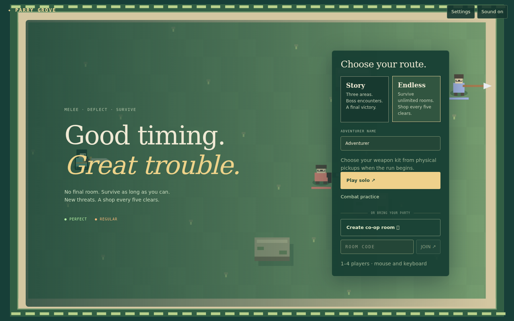
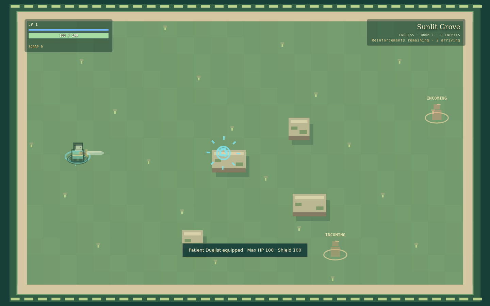
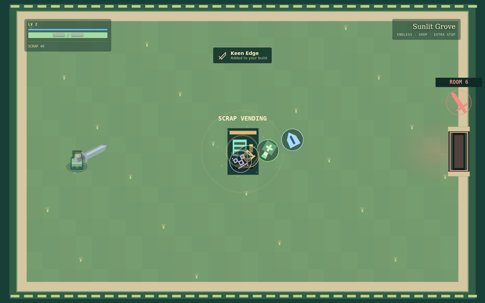
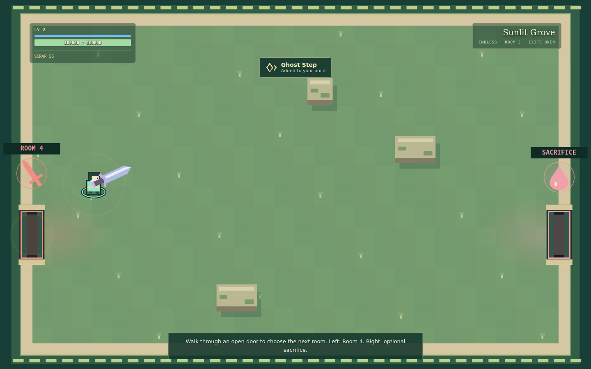
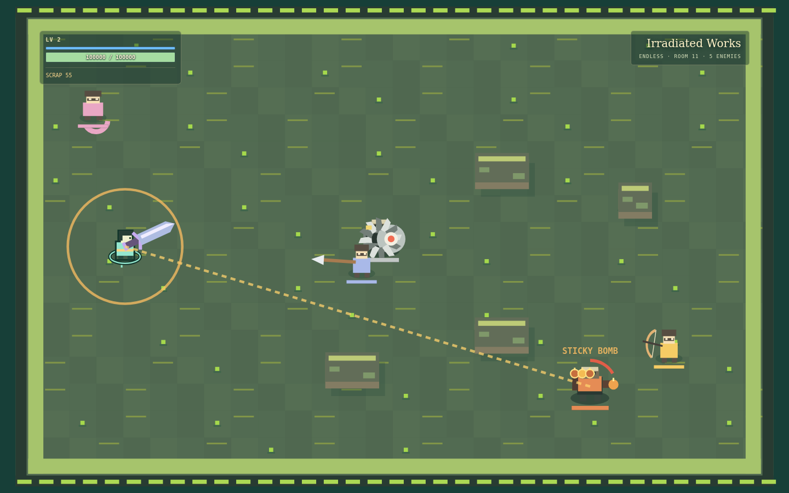
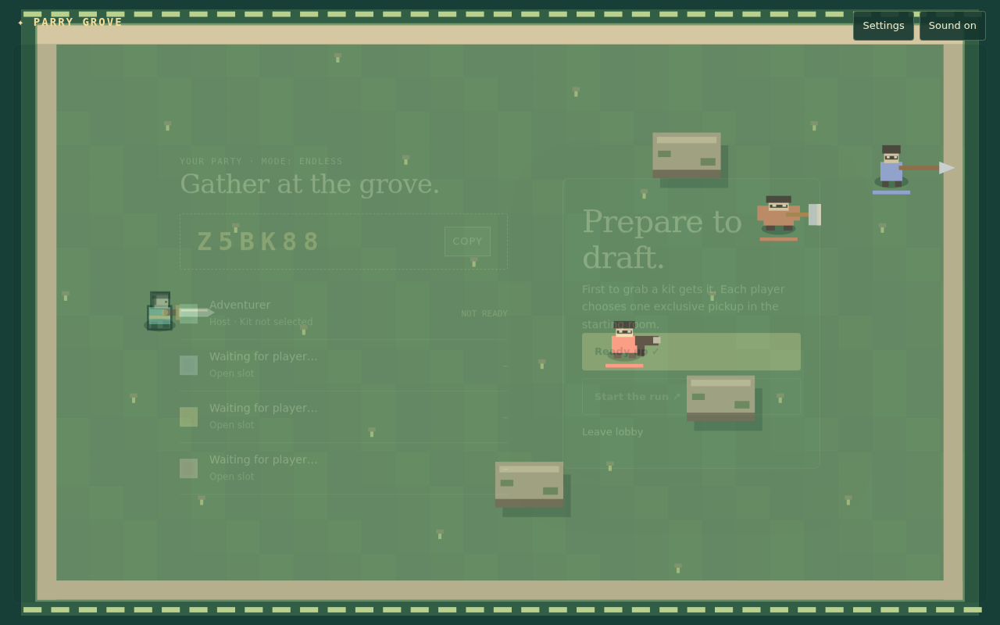

# Endless mode

Endless is an additional run type available before solo play or lobby creation.
It has no final room. Story retains all three areas, fifteen combat rooms, its
boss encounters, recovery rules, and ending. Connection mode is independent of
run type, and old room records default to Story.

## Flow and routing

Draft a kit, defeat all scheduled groups, select an upgrade, then physically leave
through an open exit. A room cannot clear while enemies, queued budget, or spawn
warnings remain. Shops are guaranteed after each fifth combat clear. Other
transitions may offer an optional sacrifice: 10% seeded chance after Room 3,
never on a shop transition, at least three intervening combat rooms between
appearances. Declining still starts the appearance cooldown. Intermissions do
not increment combatRoom or difficulty.

Optional co-op routes require every living connected player in the same 78-pixel
exit gathering zone for two seconds. Leaving, disconnecting, or membership changes
cancel agreement. Single exits retain the existing host-entry rule. At altars,
each living connected player must accept or decline before the host leaves.
Acceptance never automatically interrupts another player's choice.

Existing +8 room recovery applies once at reward completion; fallen allies revive
at half HP. Internal and shield damage carry forward. Shops retain prices,
authoritative ownership, immediate purchases, health tonics and shield repair.
They grant no free reset. Endless curses track remaining combat clears: the next
combat room is the first affected room. Shops, altars and menus consume no duration.

## Director and architecture

`game/endless.js` centralizes tuning, purpose-specific RNG, role constraints,
roster unlocks, reinforcement generation, routes and fallback reward definitions.
Run-content and engine hooks select Endless behavior explicitly. Story room/area
indices never determine Endless difficulty or trigger an Endless victory.

The server Durable Object owns co-op mode, encounters, warnings, countdowns,
stock, rewards and retry. Clients cannot override the selected mode when joining
or starting. Snapshots include the current combat room, intermission node, pending
groups, warnings, exits, countdown and statistics. Reconnect/JSON restore resumes
the existing encounter. No database migration is needed for JSON room records.

| Setting | Initial tuning |
| --- | --- |
| Budget | `floor((4 + 1.1 R + 0.7 floor(R/5)^2) (1 + 0.45 (players-1)))` |
| Enemy HP | `1 + 0.12 (R-1)` times base HP, without compounding |
| Enemy damage | `1 + 1.5 (1-exp(-0.04 (R-1)/1.5))`, approaching 2.5x |
| Enemies plus reserved warnings | 8 / 10 / 12 / 14 for 1 / 2 / 3 / 4 players |
| Role limits | Two support and two area-denial enemies; multi-role enemies consume both |
| Composition | Establish a frontline; prefer frontline at 65% ranged occupancy |
| Projectile/hazard caps | 96 hostile projectiles, 160 total projectiles, 48 hazards |
| Reinforcement trigger | <=2 active enemies or a 20-second timer; neither bypasses capacity |
| Spawn warning | 1.5 seconds, at least 150 pixels from living players |
| Elites | Room 16 onward: 4%, +0.2 percentage points per room, capped at 18%; 1.3x HP / 1.1x damage |

The damage ceiling applies to the Endless room multiplier; existing elite, curse,
defense and upgrade modifiers remain separate. Room progression does not shorten
windups or parry windows, or increase projectile speed. Existing curse effects
retain their own behavior.

Grove unlocks first, Foundry at Room 6, Irradiated Works at Room 11. The first three
five-room biome blocks follow that order, followed by seeded five-room rotations.
Campaign bosses are excluded; dedicated Endless boss milestones remain a later
extension. Later encounters include elites within the same density limits.

Reinforcements are generated lazily, keeping queued state bounded at high room
numbers. Slots are reserved during warnings. If a player or wall enters a warning,
it relocates with another full warning instead of spawning on the player.
Emission guards suppress new overflow without deleting existing threats or saving
attacks for a later burst. Cosmetic effects retain existing budgets and reduced
motion behavior. Shared multiplayer simulation is never paused.

Layouts, encounters, routes and rewards/stop loot use deterministic streams so
combat RNG cannot reroll future room choices. Rewards retain rarity weights,
exclude owned boolean effects and already-capped upgrades, and fill exhausted
choices with repeatable +5% damage, +10 maximum HP/healing, or 20 immediately
spendable party Scrap. These additional cards do not enter Story pools.

## Evidence

The controlled browser fixture uses the actual React client and Canvas renderer
with production-processed CSS. Its developer flag and world bridge exist only
inside the test bundle. It uses boosted player HP/damage and position setup for
progression checks; those images do not represent normal-difficulty balancing.
The separate built SSR Worker capture uses normal player stats and no injected
world access.













## Verification

- 1,000 seeded progression runs through Room 50 check scheduling, sacrifice
  frequency/cooldowns and roster gates. A scripted engine run clears 50 rooms and
  proceeds into Room 51. The browser also exercises the Room 100 developer control.
- Unit tests cover warning lifetime and relocation, density and role reservations,
  projectile/hazard limits, rewards, immediate funds, recovery, curse duration,
  mode authorization, retries, damage scaling, death stats and JSON restore.
- Two real WebSocket clients against Worker/D1/DO test inherited mode, shared route
  countdown, altar decisions, Room 51 warnings, guest admin denial, reconnect and
  party retry. A separate two-browser test covers lobby inheritance, draft,
  continued peer movement/timers during Settings and default admin denial.
- Browser controls cover kit pickup, actual attack inputs clearing a controlled
  encounter, reward selection, physical exits, Room 5 shop, immediate repair
  purchase, Room 6/11 progression, Room 100 control, sacrifice decline, death/retry
  and a short desktop viewport. No page errors.
- Built SSR Worker test covers hydration, run selection, keyboard movement, kit
  pickup and entry to Endless Room 1, without a world bridge.
- Four-player soak covers 55 room setups, up to 30 simulated seconds each, around
  98,000 engine ticks. Limits are checked every tick and stops clear combat entities.
  Heap after GC stabilizes around 10 MB in this Node environment; this is not proof
  of zero leaks or a device FPS claim. Exact measurements are committed in JSON.
- Story regression traverses all fifteen rooms, three boss encounters, shops,
  area transitions and final victory.
- Final focused suite: 31/31 pass. Full suite: 221/249 pass, with the same 28 failing
  names found on unchanged main `7e4a70b` (203/231 pass). Existing failures include
  stale two-area/19-enemy assertions, combat expectations, goldens, shop contacts
  and permanent sacrifices. No Story rebalance was used to change these results.
- Lint passes with the existing level3 unused-variable warning; typecheck and
  production build pass.

The existing WebSocket timing test waits for both clock advancement and observed
host movement, since guest input can advance time before host input is processed.
The encyclopedia browser test derives its portrait count from current content.
These correct stale test assumptions while preserving the behavior assertions.

## Reproduce

```sh
node --test tests/endless.test.js tests/endless-realtime.test.js
node --expose-gc scripts/endless-soak.mjs
npm run lint
npm run typecheck
npm run build
```

With `PLAYWRIGHT_MODULE` and `BROWSER_EXECUTABLE` set, run
`scripts/endless-smoke.mjs` and `scripts/endless-production-smoke.mjs`.
For `scripts/coop-ui-smoke.mjs`, set `COOP_RUN_TYPE=endless`,
`COOP_OUTPUT=docs/endless`, and `COOP_CSS` to the built stylesheet.
Raw PNGs are intermediate outputs; committed evidence is lossless WebP.
Chromium was tested; Safari/Firefox were not. Ordinary player feedback is still
needed for late-room difficulty and encounter duration: controlled automation
and boosted-survivability fixtures do not establish final balance.
