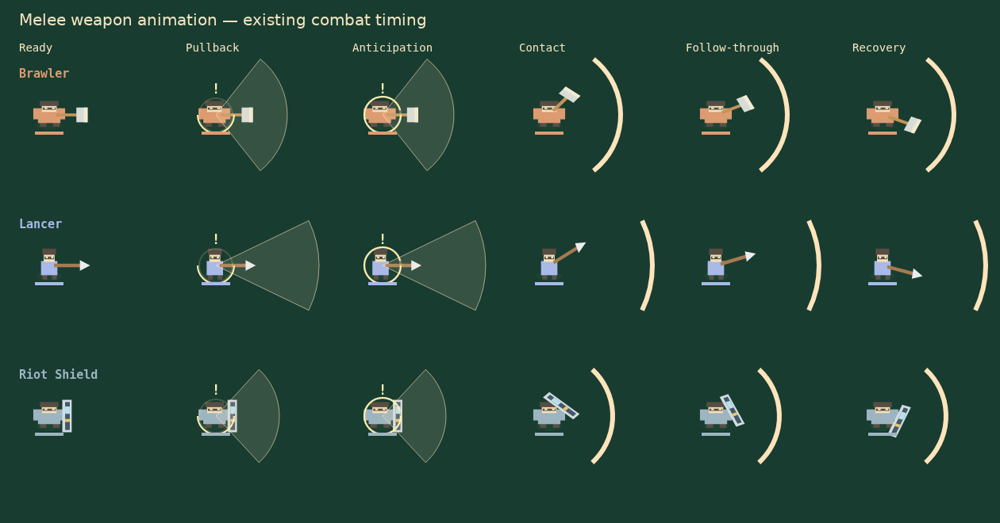
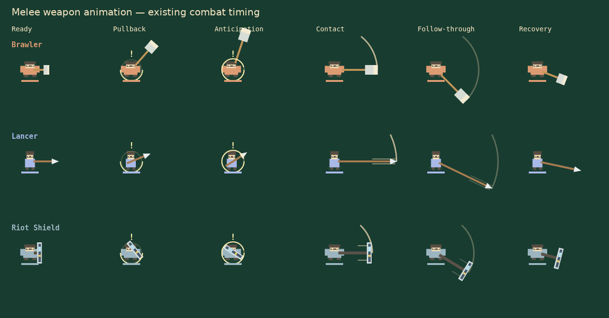
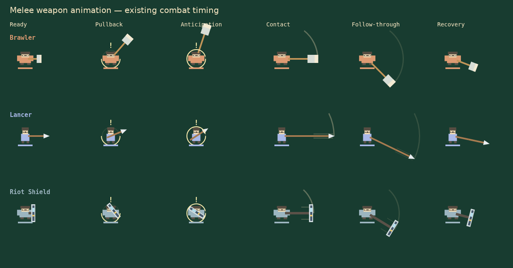

# Melee weapon communication

Previously, Brawler, Lancer and Riot Shield attacks used a filled cone during
windup, a full stationary arc afterward, and the same post-contact weapon rotation.
Their charge circles, timing, locked windup aim and sector collision tests remain.

The renderer now gives the axe a coiled backswing, the spear an axial pullback and
extension, and the shield a tucked preparation and forward bash. Contact starts
visibly extended at the existing damage instant. The remaining 0.2-second cosmetic
swing timer contains a fast sweep, brief follow-through and recovery; it never
adds an active damage window. Because spear and shield attacks already use sector
hitboxes, their forward extension also crosses their configured arc rather than
pretending they have newly narrowed line hitboxes.

The filled cone and old full stationary arc are removed. A thin, fading tip trail
lasts at most 85 ms. Its radius and angular limits come from the unchanged enemy
configuration. Weapon corners fit inside the strike reach; weapon transforms are
outside body squash/stretch. The engine still includes the player's collision
radius when checking a hit, as before. Cosmetic follow-through retains attack aim
if AI turns afterward. A capped renderer-local cache uses existing snapshot fields;
it never mutates game entities or schedules gameplay. Reduced motion lowers trail
opacity while retaining essential weapon poses and the existing charge circle.

## Visual evidence

Deterministic captures from the actual Canvas renderer, at the same states and
viewport, without CSS or a substitute drawing implementation:

Before:

After:

## Validation

- Seven new checks cover all three enemies' anticipation, defensive-parry tells,
  immediate contact, bounded reach/arc, trail lifetime, recovery, frozen strike
  direction, bounded cache and read-only entity rendering.
- 20 focused animation, feedback and real two-WebSocket-client checks pass. The
  co-op check verifies authoritative movement and timers continue advancing.
- Full suite: 231 tests, 214 passing, 17 failing. A fresh worktree at unchanged main
  (`5a29cdc`) has the same 17 failing test names: 224 total, 207 passing. No new
  failures remain. Those existing combat/progression/shop/golden expectations are
  outside this visual change.
- ESLint, TypeScript and production build pass.
- Headless Chromium renders every weapon phase and reduced-motion variant without
  page errors. A 48-enemy draw stress sample measured approximately 0.4 ms median,
  0.9 ms p95 in this environment (a renderer microbenchmark, not a device FPS claim).
- Existing game-feel browser smoke passes actual solo kit pickup, attack/parry/dash
  controls, pause/resume, crowded four-player rendering, effect budgets and reduced
  motion, without page errors.

Reproduce phase captures with `scripts/enemy-melee-smoke.mjs` using
`PLAYWRIGHT_MODULE` and `BROWSER_EXECUTABLE` for an installed browser. Optional
`MELEE_BEFORE_DIR` points to an unchanged checkout and `MELEE_OUTPUT` chooses the
capture directory. `MELEE_FRAMES=1` also records deterministic animation frames.
Raw PNGs and frame directories are intermediate outputs; committed evidence is
lossless WebP. No downloaded art, new audio, balance/configuration changes, or
simulation/networking changes are included. Safari and Firefox were not tested.
