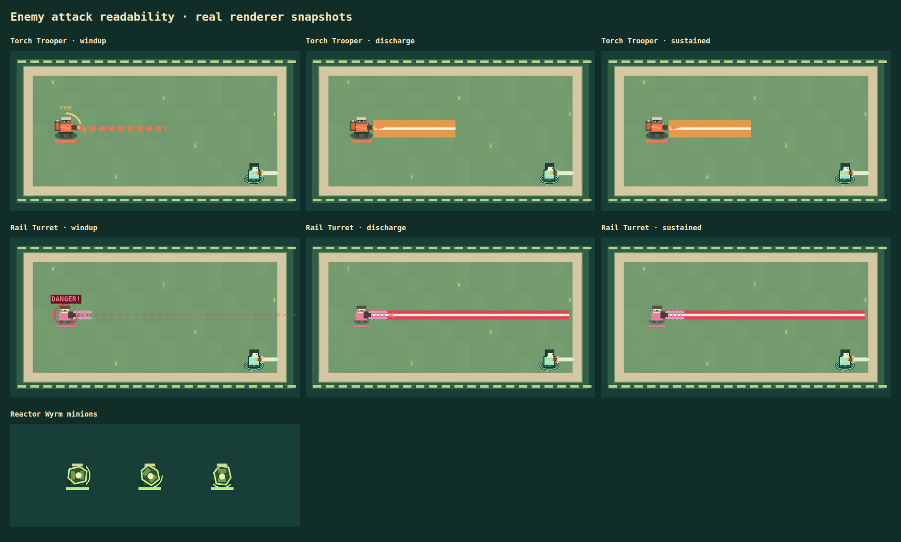
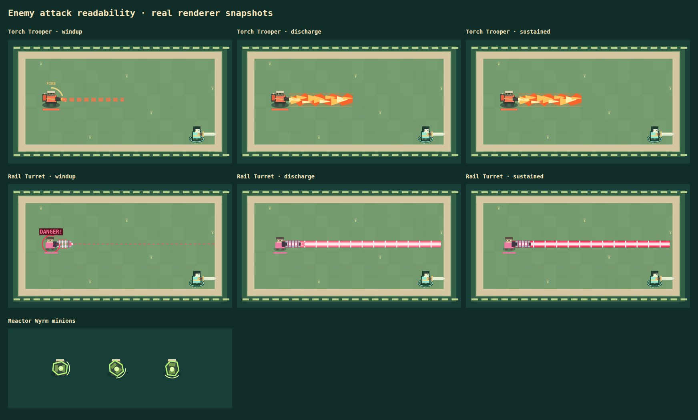
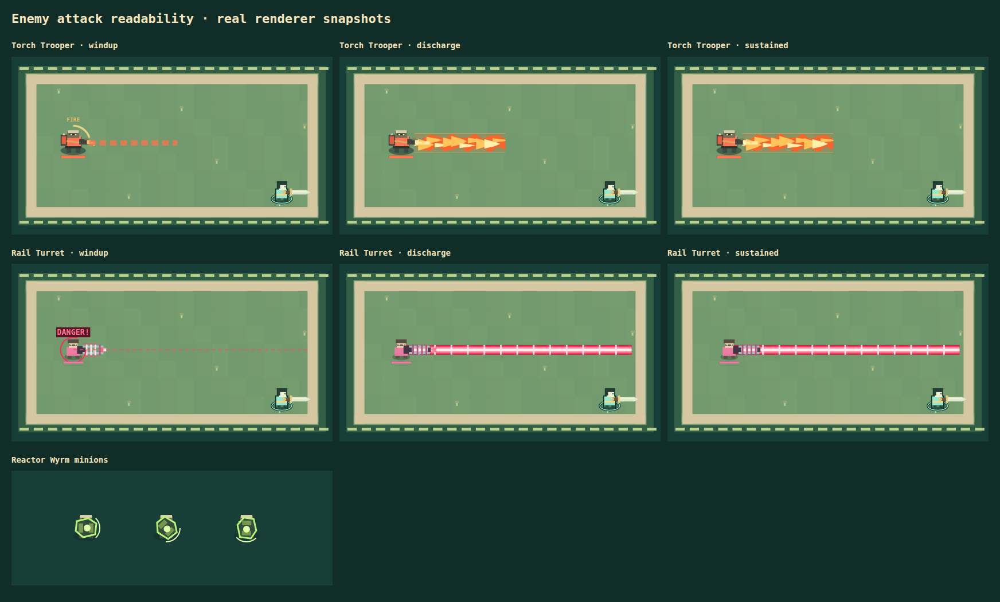

# Enemy attack readability

Based on main `527bd10727ee1f2266aeaf31882f9a7517bf10fb`.

- Reactor Wyrm Rad Wardens are invulnerable, so their misleading health bars are hidden. The boss head and destructible segment bars remain.
- Foundry Suicide Bomber base damage is reduced from **38 to 28** (about 26%). Existing armor, internal-damage release and Endless scaling still apply. Fuse, radius, movement, immunity and dash-only avoidance rules are unchanged.
- Torch Troopers now aim their weapon with the attack, build a pilot flame during the existing windup, and emit layered moving flame tongues with a restrained weapon vibration. The existing lane's complete damage bounds remain visible throughout the attack. Its warning length now matches the existing 190-pixel reach.
- Rail Turrets charge their capacitors in sequence, focus energy at the muzzle, then fire a red/pink discharge with a bright core and traveling bands. The warning stops at cover using the exact same endpoint calculation as the actual beam.

These two attacks already use persistent beam hazards rather than traveling bullet entities. The changes improve those existing beam visuals. No projectile speed, collision width, duration, tracking or parry/block rules changed. Friendly parry beams retain their existing appearance.

`game/enemy-ranged-visuals.js` contains the bounded, stateless artwork and animation constants. Geometry comes directly from the authoritative hazard snapshots. No extra network fields, simulation RNG draws, particles or timers are introduced. Reduced motion disables beam flow, ignition flash and weapon vibration while retaining readable colors and charge progress.

## Captures

The same deterministic scenes rendered by the real Canvas renderer before and after the change; these are visual fixtures, not a normal gameplay playthrough.

Before:



After:





## Verification

- Five focused checks pass: suicide damage/avoidance/through-cover fuse behavior, rail warning/discharge endpoint agreement, and 360-angle equivalence with the previous endpoint calculation.
- Chromium: actual renderer scenes have no page errors. Sixteen beam frames pass pixel bounds and snapshot immutability checks; normal animation changes frames while reduced-motion frames stay stable.
- Full suite: **205/233 pass, 28 fail**. Unchanged main: **203/231 pass, the same 28 failures**. No additional failures. Existing tests' expected bomber damage was updated for the requested balance change.
- Lint passes with the existing unused `charging` warning in `game/level3.js`; typecheck and production build pass.
- Built Worker smoke verifies rendered menu and D1 room creation. Its temporary harness omits the obsolete `Choose your weapon` menu-text assertion from the repository's original smoke script.
- No new multiplayer protocol or simulation timing changes. A fresh multi-browser session and human audio/playfeel review were not performed for this visual pass.

Reproduce the browser fixture:

```sh
PLAYWRIGHT_MODULE=/absolute/path/to/playwright/index.mjs \
BROWSER_EXECUTABLE=/absolute/path/to/chromium \
node scripts/enemy-ranged-smoke.mjs
```

Set `RANGED_SOURCE` to an unchanged checkout and `RANGED_OUTPUT` to a separate directory to capture the old renderer with the same scenes. PNGs are generated locally; committed captures are lossless WebP.
