# Game-feel polish

Inspected baseline: `ab5be05ef75e6e6d0e90da26807c391673770cfe`. There are no `AGENTS.md` instructions in this repository. Read the combat, Foundry abilities, renderer, weapon audio, interaction effects, HUD, rewards, solo clock, lobby and Durable Object snapshot paths before editing.

## Inventory and decisions

| Area | Baseline | Retained and improved |
| --- | --- | --- |
| Melee pose and trails | Partial: linear swing, separate full-arc strokes, mismatched sprite-tip/reach | Blade tip and short trailing segment now share the same pose and configured reach/area. Visual anticipation, quick strike and recovery use the existing 150 ms swing clock. A connected hit starts at contact so solo hit pause cannot hold it in anticipation. No input or damage delay. |
| Melee contact | Partial: radial particles at enemy center; no separate hit flinch | Target-surface contact metadata, directional sparks, one bright contact core and compact ring. Sprite-only recoil/squash never changes stun, position or collision. Nearby damage labels aggregate. |
| Swing/hit audio | Present but repetitive single tones | Distinct synthesized air swing and impact. Bounded subtle playback variation; no changes to enemy weapon identities. |
| Perfect/regular parry | Present: green edge glow, rings, local shake, distinct basic tones | Keep the edge glow and timer. Contact-oriented green/orange flashes and directional sparks, smaller regular response, directional local camera impulse, richer distinct sounds. Remove the redundant PERFECT label over the player; the existing central counter remains. |
| Streak presentation | Partial: capped size/burst, fixed color | Pop/settle retained; capped saturation/glow increase added. On narrow portrait screens the counter moves into the letterbox above the arena, clear of health bars. |
| Reflected projectiles | Present: friendly color and simulation targeting; no short ownership cue | Brief directional cyan/white flash and trailing streak, keyed to the actual authoritative reflection. Existing velocity/target selection unchanged. |
| Dash | Partial: simultaneous rectangle ghosts and one sound | Replace old rectangles with sampled, fading pixel silhouettes; lean/stretch the body only. Departure dust/whoosh and restrained finish particles/sound. No camera lead or extra speed-line layer: the compact arena and immediate movement are already readable. |
| Enemy charge | Present: danger text, melee wedges, laser tells, countdown arcs | Keep the danger geometry and colors. Add a restrained charge halo driven by the actual `tellTotal`/windup, not a new timer. |
| Explosions/boss impacts | Partial: radial sparks, positional weapon impact sound and shake | Bounded debris/smoke, tiny bright core and fast-expanding/slow-decaying ground ring. Ring stays within the existing blast radius. Existing layered enemy impact sounds are reused instead of duplicated. Boss death receives a stronger, limited cue even after the entity disappears. |
| Scrap | Immediate authoritative kill credit; **no world Scrap pickups** | Do not introduce collection mechanics or attraction. Aggregate cosmetic kill-origin coin flights into the existing top-left counter, then bump/chime on arrival. Spendable funds update immediately as before. Chime pitch caps and resets after a short gap. |
| Rewards/buttons | Present: reveal cards, bright focus/hover outlines, interaction rings/particles | Brief staggered card/icon reveal; selected overshoot; authoritative upgrade confirmation with the actual icon. Press squash/ripple, release settling and quiet button sound. No input locks or delayed upgrades. Existing interaction particles are not duplicated by generic particles. |
| HP/internal/HUD | Present: distinct red/amber animations, longer bars, level above shield, left Scrap and translucent boxes | Preserve these. Add a restrained red character/camera response to actual hurt events. No new internal-damage treatment that replaces the existing amber HUD cue. |
| Timing/networking | Present: 50 ms melee / 90 ms perfect solo pause; authoritative WebSocket events | Preserve solo pause exactly. Shared engine has no pause/slowdown. Feedback deduplicates authoritative IDs and never runs from predicted hits. Teammate/distant effects are attenuated. |

Two regressions discovered in the baseline were restored to the explicitly required rules: missed guards (including zero-damage Perfect-Only failures) no longer zero the streak, and physical Continue/shop/altar transitions no longer cleanse internal damage. Health loss and the three-second timer remain the only streak resets. Entering the next level still clears internal damage. Existing curse penalties, cleansing hits, reflected targeting, rewards, balance and progression remain intact.

## Boundaries and tuning

`game/feel-config.js` centralizes visual budgets and durations. `CombatFeedback` owns viewer-local contacts, flinches, ghosts, ownership flashes, coin flights and camera impulses. These data never enter player/enemy gameplay state. Engine changes attach optional `fx` metadata to existing events and add cosmetic reflection/dash-finish cues; the event pool clears all metadata on reuse. Compact WebSocket snapshots forward that metadata.

Maximum active budgets: 240 particles, 28 labels, 24 rings, 24 contact flashes, 40 flinch records, 32 afterimages, 32 reflection flashes and 8 coin flights. Shared sound limiting is retained; the new feedback bank adds a 12-voice cap and per-cue retrigger limits alongside the existing 16 enemy voices. Large pickups merge; chime pitch caps at five semitone steps and resets after 550 ms.

Canvas listens to changes in `prefers-reduced-motion`: no camera impulses, flinches, dash lean or afterimages; smaller particle counts and weaker flashes. Existing CSS reduced-motion behavior is preserved and extended to new reward/button effects. Pixel sprites use crisp discrete draws, not motion blur.

## Validation

- `npm run typecheck`, `npm run lint`, `npm run build`: pass.
- Full `npm test`: **209 tests, 192 pass, 17 fail**. Unchanged baseline: **196 tests, 175 pass, 21 fail**. All 13 added tests pass. The four restored-rule regressions now pass; every remaining failure also occurs on baseline. They concern stale balance/targeting expectations, legacy mine/magnet/level-clear assertions, obsolete vending/sacrifice behavior, and old performance fingerprints. No expected results were rewritten to hide failures.
- New feedback tests: duplicate/stale snapshots, budget ceilings and expiry, mass-credit aggregation, reduced motion, local/distant scaling, hitbox-aligned swing samples, pooled metadata clearing, reflection/dash-finish cues, rendering read-only state, distinct finite audio, sound caps and pickup pitch reset.
- Two real local WebSocket clients in the Cloudflare Worker emulator receive the same melee contact/kill metadata, retain the streak timer and reject replayed effects. Movement and authoritative time continue advancing after a perfect parry. Existing network and realtime-audio tests pass.
- A separate before/after simulation comparison ran **3,600 matching authoritative ticks** at 12/32/180 enemies, including two-player movement, melee, repeated dashes, damage and projectiles. All state matched after removing presentation events/event serial; the explicitly restored streak/room rules have separate tests.
- Chromium captures cover melee, perfect/regular parry and reflection, HP/internal accumulation, dash ghosts, mass Scrap, selected upgrade confirmation, explosions, boss death, mobile layout and reduced motion. The actual `Game` client was also mounted from the source bundle and exercised through kit pickup, movement, melee input, repeated dash, parry, pause and resume. No page exceptions.
- Browser performance fixtures include four players with 32 enemies/80 projectiles and a deliberately excessive 180-enemy/200-projectile scene. Budgets remain bounded. See `game-feel/browser-results.json` for the measured median/p95 values. This shared runner uses software rendering and exhibits long-tail frames; **steady 60 FPS is not established by these measurements**. A physical-device playtest remains appropriate.

Install note: baseline `npm ci` fails because its npm lock has inconsistent ajv/json-schema-traverse entries. Local checks used `npm install --ignore-scripts --no-package-lock`; no dependency manifests or lockfiles were changed.

Limitations: human audio/playfeel and cross-internet latency were not evaluated. The complete two-browser Vinext lobby flow was not completed reliably in the preview; the real two-socket Worker integration above is the multiplayer verification. These changes are review-only, not a deployment.

## Captures

Before/after images use identical seeded scenes and current HUD data, swapping the renderer from the inspected baseline for the **before** images. They isolate rendering changes, not a claim of identical screenshot animation timestamps. `app-solo-after` exercises the actual client and inputs. WebP copies are lossless.

| Scene | Before | After |
| --- | --- | --- |
| Perfect parry | 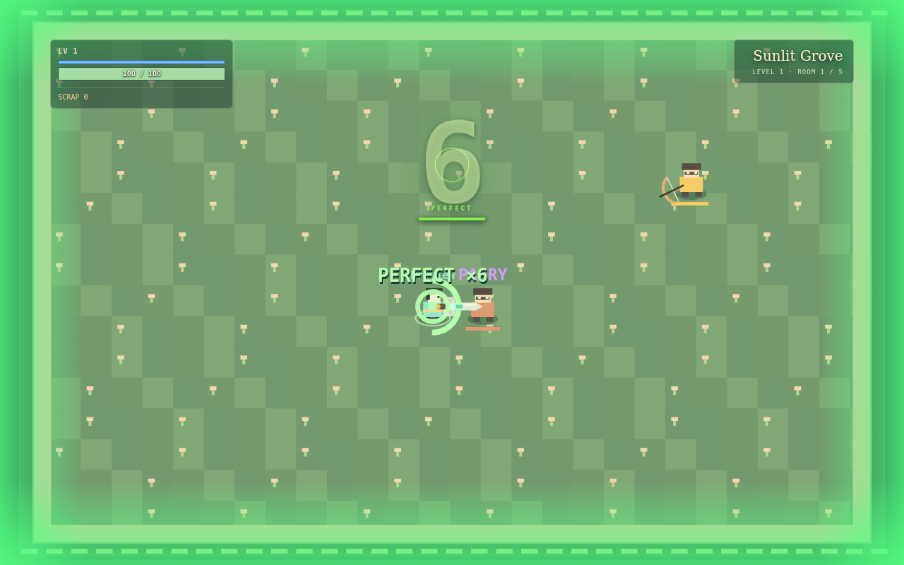 | 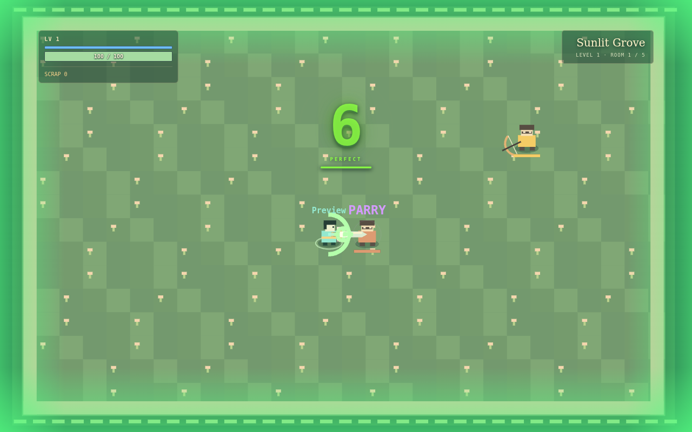 |
| Melee impact | 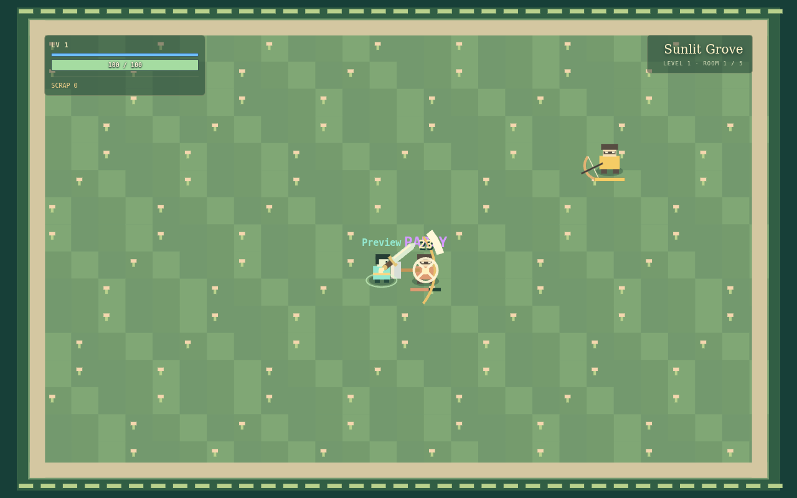 | 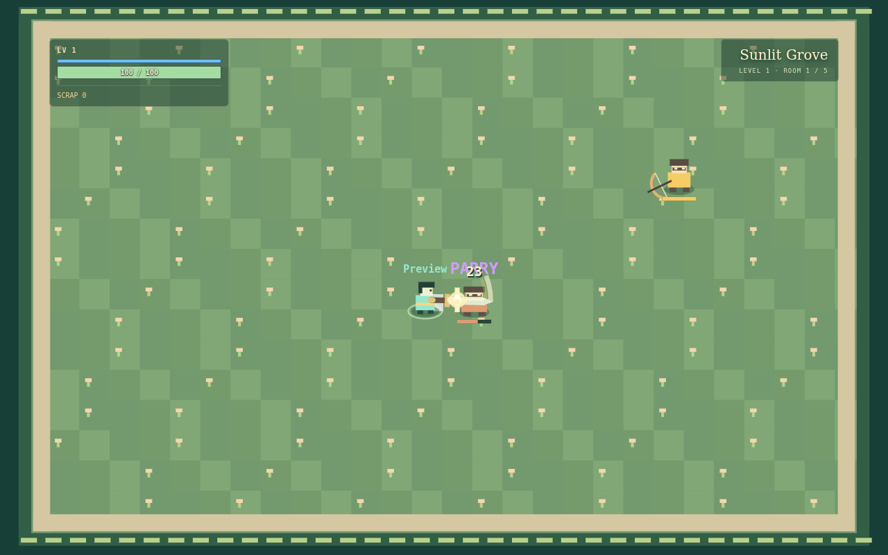 |
| Dash | 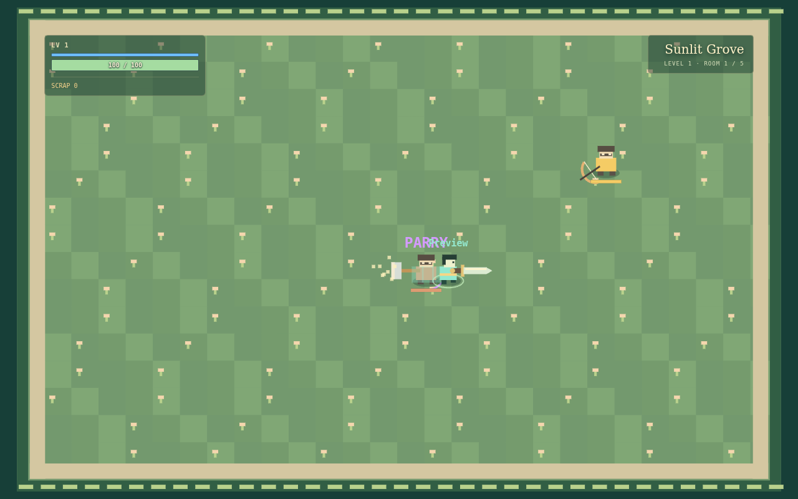 | 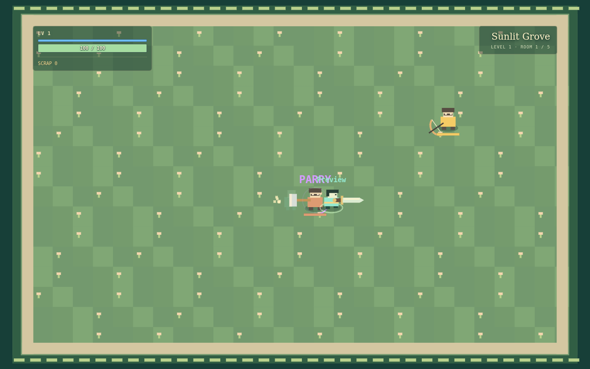 |

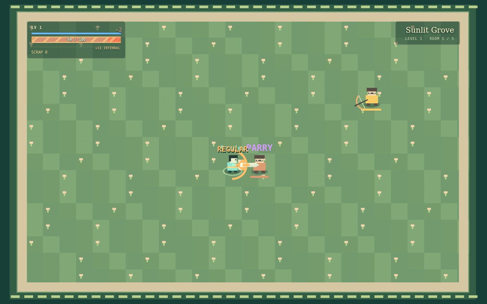
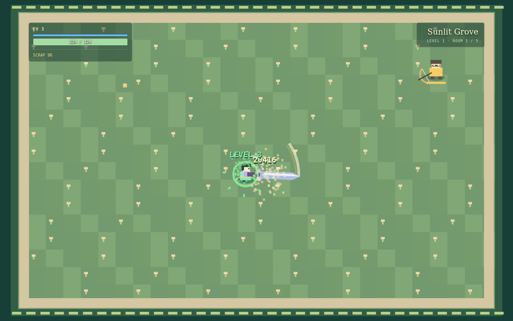
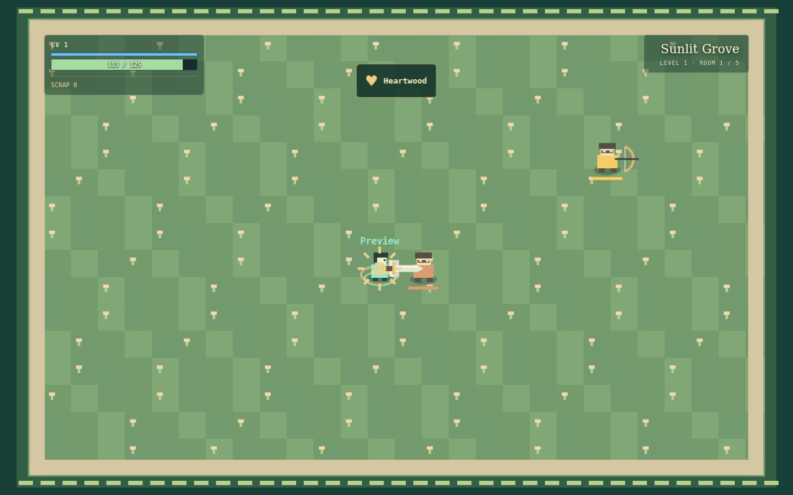
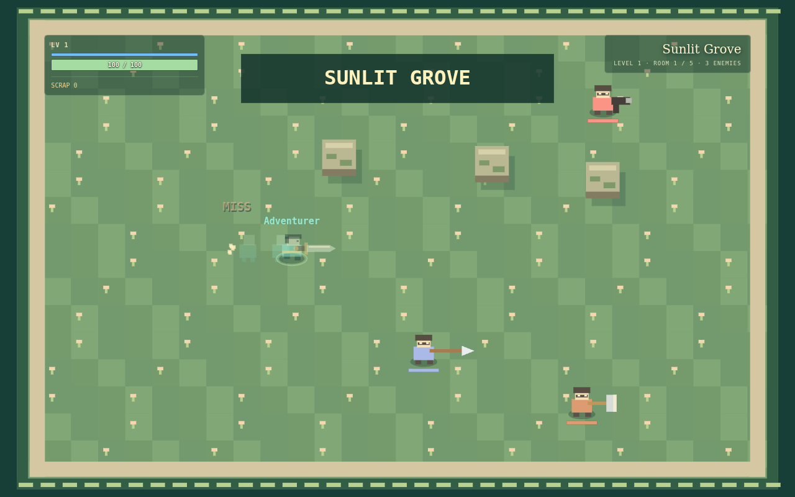
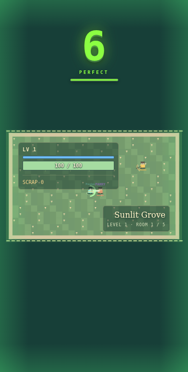

Reproduce the fixture captures with `node scripts/game-feel-smoke.mjs` after installing dependencies and making Playwright/Chromium available. `PLAYWRIGHT_MODULE`, `BROWSER_EXECUTABLE` and `FEEL_OUTPUT` optionally select a local installation/output directory. `FEEL_BEFORE_DIR` may point to an unmodified checkout for matched baseline captures. The fixture server is test-only and does not add production debug routes.
