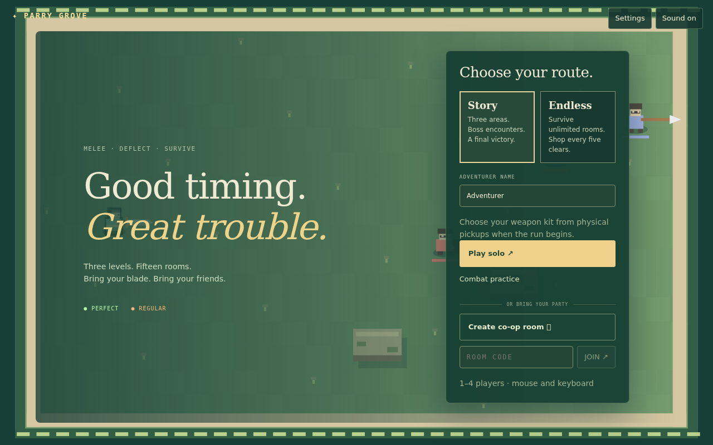
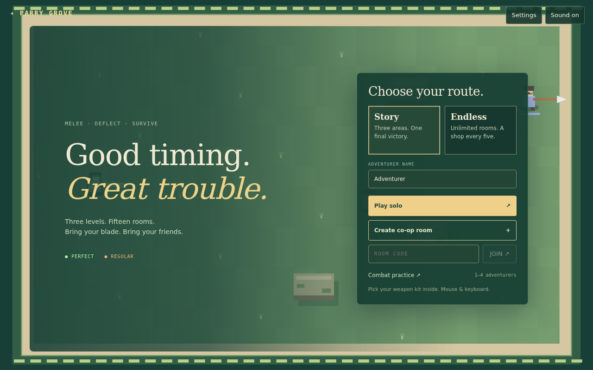
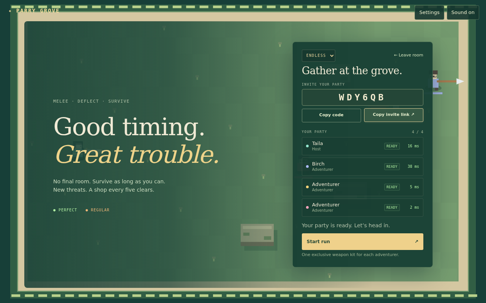
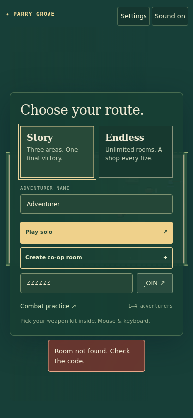

# Main menu and party lobby refinement

Base: main `189f386` (PR #38). Work is on a separate feature branch; no main
commit, merge or deployment is included.

## Design preserved

The existing forest card surface/shadow, outer arena frame, cream/sage copy,
Georgia editorial headings, Arial copy, tracked monospace labels, button corner
radius and primary/secondary button primitives remain. No art, font, palette or
button-token replacement. The screenshot's established gold is retained exactly:
primary background `rgb(239, 209, 139)`, text `rgb(36, 71, 53)`, Arial and 3 px
corners compare identically in before/after computed-style measurements. The
approximate colors in the brief were not used to overwrite existing tokens.

At 1280×800 the menu card changes from 634.7 px tall to 502.5 px, about **21%
shorter**, with a 370 px width instead of 330 px. Solo and co-op actions are
immediately stacked using the same full-width buttons; the room-code/join row is
next, with practice and the weapon-pickup caption below. The left headline has a
slightly stronger green gradient for readability over the existing live demo.

## New flow

- Adventurer name persists locally, with a safe default if storage is unavailable.
- Creating, joining, or opening a valid six-character `?room=…` invite transitions
  the existing right-hand card into the lobby. A same-room saved session resumes
  instead of creating a duplicate member. Invalid/full-room errors retain the menu.
- Hosts select Story/Endless from a forest-styled route badge. Guests see the
  current badge without edit controls. A real route change resets guest readiness
  and keeps the host ready; the server rejects guest/invalid/active-run changes.
- Room code, copy-code and copy-invite controls include brief confirmation. Invite
  URLs contain only the room parameter, never session credentials. When clipboard
  access fails, selectable code/link fields provide a fallback.
- Four compact rows show slot colors, names, host/guest identity, readiness, and
  measured round-trip ping. Unmeasured/disconnected latency displays “—”. Empty
  slots use muted dashed borders. No invented latency values.
- Guests ready/unready; the host starts after peers are ready and connected.
  Creation automatically readies the host. Returning/transferred hosts can ready
  automatically before requesting start; the server's existing readiness check still
  authorizes the run. Repeated connect/leave interactions are guarded.
- Leave or Escape returns to the same menu and removes the invitation parameter
  to avoid automatically rejoining on refresh. Tab order stays native, Enter joins
  from the code input, and focus uses a 1 px warm-gold outline.
- Buttons/cards use short 120 ms feedback. Hover/focus ticks and subdued confirm
  chimes reuse the existing capped audio system and mute/volume controls. Browser
  autoplay policy still requires an initial interaction. Reduced-motion settings
  suppress entry/hover movement.

## Scope of network additions

Only two lobby capabilities are added to the existing authority: a host-only
`runType` action and public connection/ping presentation fields. Lobby presence
refreshes at most once per second per room from existing heartbeat/probe traffic.
Ping comes from server-issued probe round trips; HTTP-only connections have no
invented WebSocket measurement. The extra member/ping lookup is skipped during
active runs. Simulation, input/prediction, combat, progression and timing are not
changed. Older JSON/binary readers can ignore the extra lobby fields.

## Validation

- Dedicated browser harness uses the production API and Durable Object export,
  four isolated Chromium contexts and an in-memory D1 database; no lobby fixtures
  or mocked multiplayer authority.
- Name persistence, Enter join, invite auto-join, clipboard success/fallback,
  same-tab lobby refresh, measured pings, guest edit restrictions, route/readiness
  changes, Escape leave/rejoin, four-client Endless start and solo entry pass.
- A 390×844 viewport has no horizontal overflow. Keyboard focus, reduced motion
  and mute preservation pass. Browser page-error list is empty.
- Existing four-client combat browser regression also passes with updated lobby
  selectors: melee clear, individual rewards, route consensus, refresh preserving
  player/HP, temporary reconnect, and simulated latency/stall profiles. These
  functional checks do not establish new WAN/performance guarantees.
- Focused menu/network/core/DO tests: 23/23 pass. Typecheck, build and built-Worker
  smoke pass. Lint has no errors and one existing `level3.js` unused-variable warning.
- Full suite: 281 tests, 255 pass and 26 fail. Base main: 278 tests, 252 pass,
  the same 26 failures. No new failing names. Details: [checks.json](checks.json).

Not verified: Safari/Firefox, physical touch devices, deployed internet sessions,
or audible quality through real speakers. Screenshots are native browser renders;
the mobile image includes the intentionally exercised room-not-found error state.

## Captures

Before:

After:

Reproduce with `node scripts/menu-lobby-browser.mjs`, providing
`PLAYWRIGHT_MODULE` and `BROWSER_EXECUTABLE`. `MENU_BASELINE=1` reads the base menu
and CSS from `origin/main` for the before capture; `MENU_OUTPUT` selects an output
directory. Existing co-op smoke/browser harness selectors were updated for the
new in-card lobby without removing their checks.
