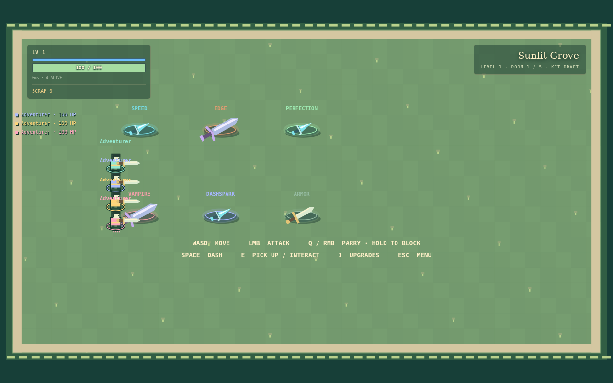
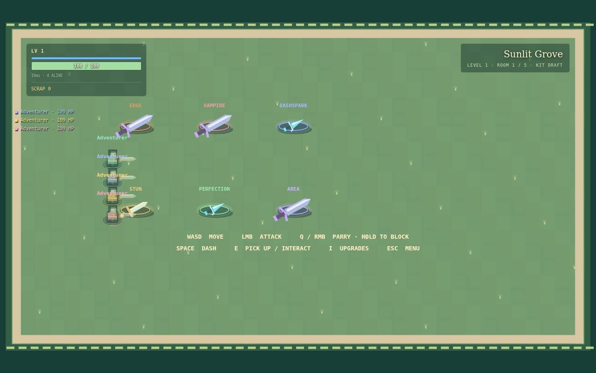

# Multiplayer authority, responsiveness and verification

Historical report for PR #37. The [smoothness follow-up](multiplayer-smoothness.md)
supersedes the input queues, effect hold, render smoothing and wire-format details
below; these original measurements remain for comparison.

This pass replaces message-driven combat with an independent authoritative room
clock and immediate local startup prediction. It does not claim production WAN
certification. Source was inspected before implementation: `527bd10`; subsequent
main changes through `7a06e80` were integrated on the feature branch. No main
branch commit or merge is part of this delivery.

## What existed and what was retained

The shared engine, room codes, four-player parties, authoritative hit resolution,
compact snapshots, renderer/audio hooks, individual rewards, shared scrap/stock,
Story and Endless content already existed. They remain. Combat balance, parry
windows, projectile targeting, internal damage, HP, HUD layout and solo-only hit
pause were not redesigned. Existing network test fixtures were updated to use
current E-to-purchase and sacrifice behavior; no health penalty was reintroduced.

The old transport advanced combat from input handlers, accepted pending sockets
into broadcasts, lacked same-tab session recovery, and mixed D1 and object room
ownership. The baseline measured 64 snapshots sent to an unauthenticated socket.
That is now zero.

## Runtime structure

- `app/api/room/route.ts`: bounded/versioned requests, native admission limit,
  D1 room creation/discovery, then forwarding to the room object. There is no
  alternate live D1 authority when the object fails.
- `game/room-server.js` (`room-realtime.ts` export): Durable Object lifecycle,
  HTTP and WebSocket authentication, controller replacement, receipts, snapshot
  credits, persistence, alarms, metadata and telemetry.
- `game/room-simulation.js`: fixed steps, command queues, action deduplication,
  disconnection grace, historical replay and reliable cosmetic events.
- `game/multiplayer-client.js`: session recovery, ordered command batching,
  local prediction/reconciliation, clock sync, interpolation, watchdog and
  HTTP fallback. `Game.jsx` connects it to the existing engine and renderer.
- `game/net-protocol.js`: shared limits, validation and protocol version 2.
  `room-snapshot.js` compacts authoritative state.

D1 contains discovery/metadata only. One Durable Object owns lobby and active
state. Discrete actions carry stable IDs plus persisted monotonic action sequence
numbers; retries over either transport do not purchase, choose or start twice.
The bounded result cache retains 256 results, while a high-water mark prevents
old evicted actions from running again. Rejected actions operate on a draft and
do not destroy valid compensation history. Run IDs reject stale-run mutations.

## Timing and input

A non-overlapping accumulator executes exact 1/60-second engine steps, with six
catch-up ticks maximum. Excess elapsed time is discarded and measured. Fresh
movement never applies retroactively to elapsed ticks. Inputs are produced at
60 Hz, batched near 30 Hz, and acknowledged by sequence; snapshots target 20 Hz.
The client resends its latest twelve unacknowledged commands, and the server
bounds each future queue to four commands under overload.

Local movement, collisions, dash and attack/guard startup reuse the shared engine.
Prediction cannot damage enemies, grant scrap, alter HP or emit authoritative
outcomes. A snapshot removes acknowledged inputs and replays remaining commands.
Small position corrections decay; corrections over 35 pixels snap. Remote state
uses 33–83 ms adaptive interpolation. Scene transitions clear interpolation
history. Predicted startup effects are suppressed when confirmation arrives;
hits and successful parries are never predicted.

Server nonce probes measure RTT; the client estimates clock offset from recent
low-RTT samples. View ticks follow the rendered interpolated frame and must match
an authenticated server snapshot receipt. HTTP snapshot numbers are separate
from socket flow-control acknowledgments.

## Late parry policy

The design was recorded before implementation in [multiplayer-design.md](multiplayer-design.md).
The server retains twelve ticks, capped at 200 ms wall time, of complete gameplay
state and actual per-tick controls. A validated late defensive edge can replace
historical facing/guard input and replay the whole world. Newly received movement
is not rewound and the correction does not advance the simulation clock.

Replay includes HP/internal damage, provisional death, streak/timer, enemy stun,
projectile consumption/ownership/reflection, RNG, cover and rewards. The original
engine decides perfect versus regular parry, including its existing 90 ms perfect
window. Area, non-parryable and dash-only attacks preserve their original rules.
Two defenders contesting one projectile cannot reflect it twice. Commit barriers
for accepted external actions, membership, scene/run changes and reconstruction
prevent replay across irreversible decisions. Arbitrary client timestamps and
forged view ticks cannot request unrestricted rewind.

**Tradeoff:** authoritative HP/death inside the correction interval can be revised.
Result actions wait for that interval, and confirmed combat cosmetics are held
for up to 200 ms before delivery. Local startup remains immediate. Very late
inputs, unmeasured transports and corrections across barriers receive no rewind;
this cap cannot guarantee a parry at every latency. HTTP fallback does not gain
unverified historical compensation. There is no shared multiplayer hit pause.

## Recovery, security and durability

Session storage keeps only protocol/code/player/token for same-tab recovery.
A refresh restores full state before prediction/rendering. Invalid credentials
clear the saved session. A five-second heartbeat watchdog reconnects with bounded
backoff; HTTP fallback uses the same controller authority and action identity.
Healthy WebSocket lobbies no longer poll HTTP. Reconnection status is visible.

A member has 90 seconds of grace. Absence neutralizes held controls without
healing. Duplicate packets cannot keep stale controls alive; new input must
arrive within 1.5 seconds. If every controller is absent, simulation stops and
persists. If teammates remain, disconnected characters are still vulnerable.
Grace members do not block door, draft, altar or reward consensus and can miss an
unchosen reward/kit. Existing inventory and HP remain. Explicit leave removes
membership and transfers host. An empty room alarm drains metadata writes,
deletes discovery/storage and prevents a pending heartbeat resurrecting it.

Sockets authenticate within three seconds; at most eight including pending
connections, one controller per member. Unauthenticated connections receive no
snapshots. Replacement invalidates old controller credentials and receipt maps.
Protocol mismatches fail explicitly. Inputs validate types/finite ranges,
monotonic counters and bounded sequence jumps. Actual streamed body/message byte
limits are 12 KB HTTP and 4 KB WebSocket. Native admission limits are 30 room
create/join operations/minute and 120 socket handshakes/minute per key; Cloudflare
limits are approximate and per location. Member buckets additionally bound
messages (60/s, burst 120) and discrete actions (4/s, burst 8).

Normal checkpoints coalesce once a second through one serialized write chain.
Important progression/combat transitions and discrete acknowledgments await
storage durability. A failed write does not poison future saves. Ordinary crash
recovery can lose up to approximately one second of simulation; confirmed
critical actions are durable. Reconstruction starts a new transport epoch,
resets socket credits/probes and invalidates old rollback history.

Events have monotonic reserved IDs, a 256-entry ring, batches of 64, renderer
acknowledgments and two-second wall-time expiry. Old cosmetic events are dropped
on recovery rather than replayed over restored state. Each socket has four
unacknowledged snapshot credits and a five-second stalled-receiver deadline;
receipt maps are bounded to 64. No undocumented server `bufferedAmount` is used.
Metrics include tick/replay cost, overruns, discarded time, coalescing, bytes,
auth failures, gaps, reconnections and persistence errors; session secrets are
not logged. `room_metrics` is emitted every 30 seconds.

## Measured evidence

Small local samples on shared test infrastructure, not population percentiles:

| Four-client profile | Before dash/guard/swing startup (ms) | After (ms) |
|---|---:|---:|
| 0 ms RTT | 70.4 / 55.6 / 52.5 | 12.3 / 14.8 / 12.7 |
| 50 ms RTT, ±10 ms jitter | 124.4 / 110.1 / 91.4 | 5.7 / 1.9 / 7.4 |
| 100 ms RTT, ±10 ms jitter | 153.8 / 157.0 / 156.2 | 24.4 / 13.0 / 33.6 |
| 150 ms RTT, ±10 ms jitter | 223.8 / 176.5 / 172.6 | 19.8 / 28.3 / 9.8 |
| 100 ms RTT, 1% stall model | 159.9 / 341.3 / 162.6 | 6.9 / 6.8 / 13.9 |
| 100 ms RTT, 2% stall model | 309.7 / 169.1 / 187.6 | 9.3 / 7.9 / 5.6 |

These are real renderer startup observations after injected controls, including
CDP/RAF scheduling. The browser loss model inserts ordered 200 ms message stalls,
not kernel TCP loss. Full confirmation/correction samples and wire counts are in
[browser/results.json](multiplayer/browser/results.json); the startup table does
not mean confirmed hits or remote movement have zero latency.

A separate two-client controlled projectile trial achieved 3/3 perfect parries
at each 0/50/100/150 ms profile, and 3/3 under each 100 ms 1%/2% application-message
drop profile with 33 ms retries. Only one actual message was dropped in the final
2% sample and none in the 1% sample; this is a small deterministic functional
check, not statistical loss robustness. HP/internal/streak and single reflection
were checked. See [parry-profiles.json](multiplayer/parry-profiles.json).

The browser samples reported one correction (maximum 13 pixels); acknowledgment
medians increased from 109 ms at zero injected RTT to 259 ms at 150 ms RTT,
with individual samples up to 409 ms under the stall profiles. Immediate startup
does not remove authoritative confirmation delay. These input profiles use the
kit-draft scene with combat controls enabled; the separate controlled combat
check is not a general combat movement stress benchmark.

The short four-socket server measurement changed snapshot rate from 29.23 to
19.54 Hz, average snapshot size from 3,957 to 5,912 bytes, and host receive rate
from 115,682 to 115,534 bytes/sec. Richer protocol metadata offsets frequency
savings: **no bandwidth reduction is claimed**. The after run had zero overruns,
zero discarded time and zero unauthenticated snapshots. See baseline/after JSON.

## Verification and scope boundaries

- `npm run lint`: no errors; one existing unused `charging` warning in level3.js.
- `npm run typecheck`, `npm run build`, `node tests/build-smoke.mjs`: pass.
  The smoke test uses the built Worker and verifies menu, protocol, durable start,
  independently advancing time and socket upgrade.
- `node --test tests/multiplayer-core.test.js tests/multiplayer-realtime.test.js`:
  19/19 pass, including actual Miniflare Durable Objects, four sockets,
  authentication boundaries, replacement, silence, forged input, late death
  correction, event/credit caps, shared-stock E purchase, action retries,
  checkpoint failure and object reconstruction.
- Full `npm test`: 270 tests, 244 pass, 26 fail. Main `7a06e80`: 251 tests,
  223 pass, 28 fail. No new failing test names. Two legacy network fixtures were
  corrected to current interaction semantics. Exact failing names and comparison
  are in [checks.json](multiplayer/checks.json); this suite is **not green**.
- Real Chromium: four independent contexts with actual DO/WebSocket transport;
  immediate startup profiles, server melee kills, four independent reward choices,
  route consensus, same-tab refresh preserving ID/HP, temporary disconnect while
  other clients continue, reconnect; zero page errors.
- Accelerated four-player 30-room Endless simulation/replay soak: boosted test HP
  and damage, 60 simulated seconds maximum per room, forced transition after cap.
  This is bounded engine/load evidence, not a natural 30-room playthrough or
  four-network-client endurance run. It ran 56,248 ticks and 462 ten-tick replays.
  Isolated tick median/p95/max: 0.168/0.473/79.547 ms; replay median/p95/max:
  1.992/4.848/13.264 ms. History peaked at 243,101 bytes and events at 256.
  The long tick outlier remains a performance limit; a prior concurrent run
  reached 480 ms. No hard frame-time guarantee is claimed. See [soak.json](multiplayer/soak.json).

Test-only object subclasses expose fixture/reset/failure routes exclusively via
esbuild test plugins. They are absent from the production export/bundle. Old
D1-seeded fixtures now explicitly seed the DO instead of reintroducing production
D1 gameplay ownership. No production admin testing endpoint was added.

Not verified: deployed cross-internet sessions, kernel packet loss, Safari/Firefox,
mobile rendering, many concurrent rooms, prolonged browser/network soak, real
Cloudflare regional migration or human audio/playfeel. Automated measurements
support improved responsiveness; they cannot guarantee perfectly smooth play.

## Coverage of the implementation requirements

| Area | Completion and evidence |
|---|---|
| Baseline / defect verification | Source audit, baseline JSON, main comparison, before browser capture |
| Unified authority / idempotency | DO from lobby onward; raw HTTP/WS concurrency and retries |
| Security / limits | Auth deadline, controller, payload/rate/sequence/credit tests |
| Independent simulation | Fixed-step unit tests and input-free actual DO time advancement |
| Acks / reconciliation | Shared prediction, bounded queues, replay and browser metrics |
| Immediate startup | Dash/guard/swing renderer observations; prediction immutability test |
| Clock / interpolation | Nonce RTT, displayed-frame tick, scene reset; simulated profiles |
| Parry compensation | Prior written policy, whole-world tests, controlled network trials |
| Session recovery | Same-tab browser refresh and temporary reconnect |
| HTTP fallback | Same authority/actions; mixed-transport controller and credit tests |
| Persistence / lifecycle | Write-fault recovery, reconstruction, grace and shop tests |
| Reliable events | Ring/batch/expiry/ack/gap bounds and reflection/startup dedup tests |
| Protocol / backpressure / telemetry | Version denial, slow receiver and native admission tests |
| Mechanics preservation | Shared engine, solo-only pause; no balance redesign |
| Delivery | Build/suite/evidence/soak; WAN/platform/human limitations above |

## Hosting implications

Active 60 Hz timers keep a room awake; alarms handle idle deadlines, not combat.
At approximately 30 input messages plus one ping per player each second, four
players produce roughly 124–126 incoming WebSocket messages/sec before occasional
acks/actions. Cloudflare bills incoming WebSocket messages at a 20:1 request
ratio. That is roughly 22,000–23,000 billable DO requests per active room-hour.
One active 128 MB object-hour is approximately 460.8 GB-s. One-second checkpoints
write roughly 7,200 state/code keys per hour, plus critical writes and event-ID
reservations; D1 metadata heartbeats are about one per minute.

Using the documented Paid overage rates ($0.15/million requests, $12.50/million
GB-s and $1/million SQLite rows written), these are quantities to budget, not a
hosting quote. Plan fees/allowances, Worker requests/CPU, D1, event traffic,
retries and storage differ. Network volume is also material (~0.46 MB/sec total
outbound for a four-member room in the short sample). Re-measure deployed rooms.

Official platform references:
- https://developers.cloudflare.com/durable-objects/platform/pricing/
- https://developers.cloudflare.com/durable-objects/concepts/durable-object-lifecycle/
- https://developers.cloudflare.com/durable-objects/best-practices/websockets/
- https://developers.cloudflare.com/durable-objects/api/sqlite-storage-api/
- https://developers.cloudflare.com/workers/runtime-apis/bindings/rate-limit/

## Captures and reproduction

These still images document scenes and client consistency, not latency. Use the
JSON measurements for responsiveness; no before/after video was captured.

Run `node scripts/multiplayer-measure.mjs`,
`node scripts/multiplayer-parry-profiles.mjs` and
`node --expose-gc scripts/multiplayer-soak.mjs` from the repository root.
The browser harness additionally needs `PLAYWRIGHT_MODULE` (absolute path to an
installed Playwright module) and `BROWSER_EXECUTABLE` (Chromium executable).
`MP_SOURCE`/`MP_OUTPUT` optionally point to a baseline checkout/evidence directory.
Browser/runtime packages are external test tooling, not new game dependencies.
