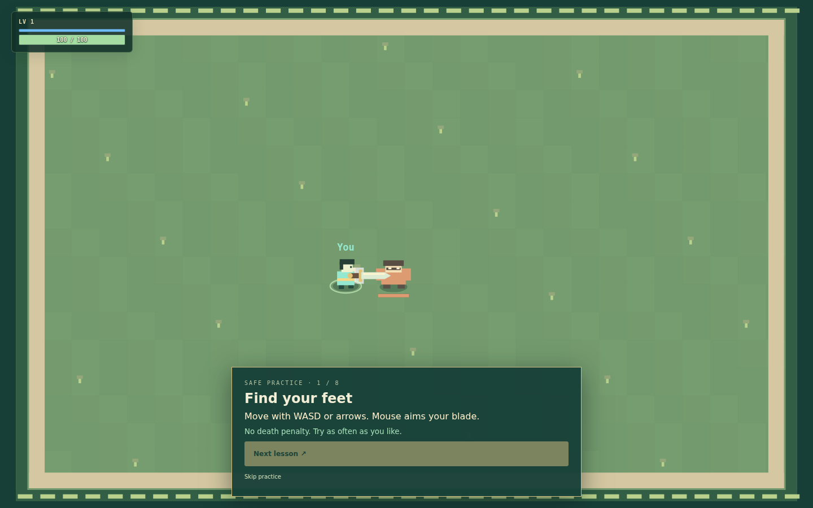
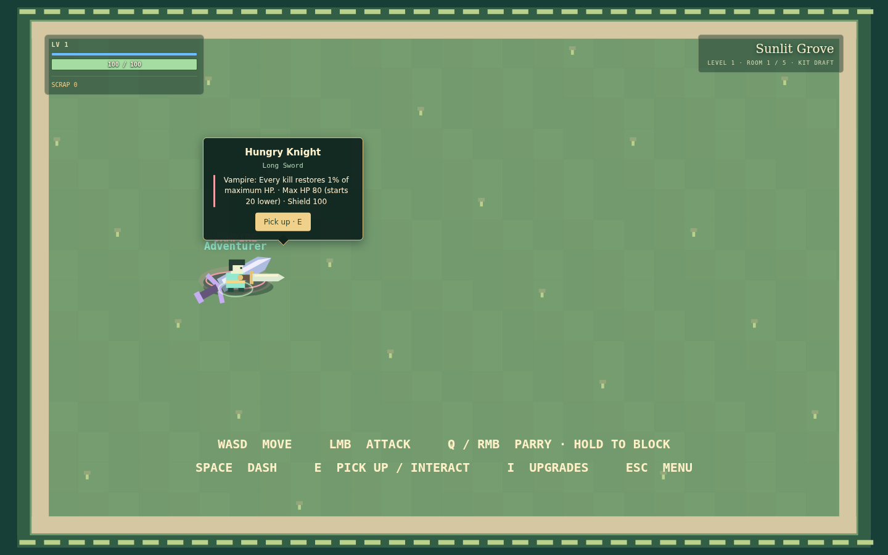
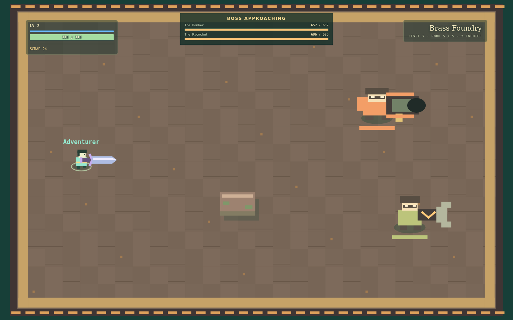
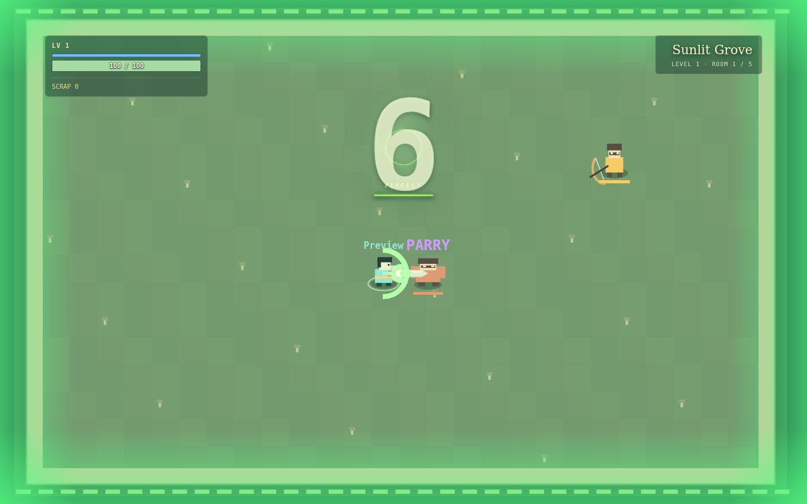
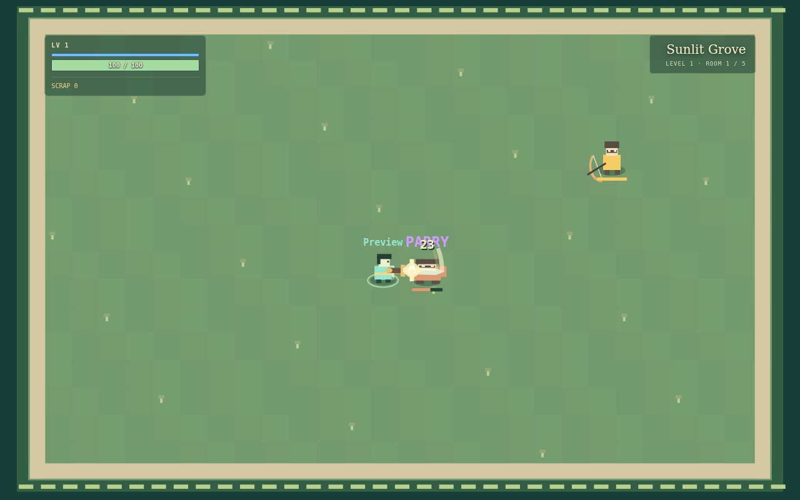
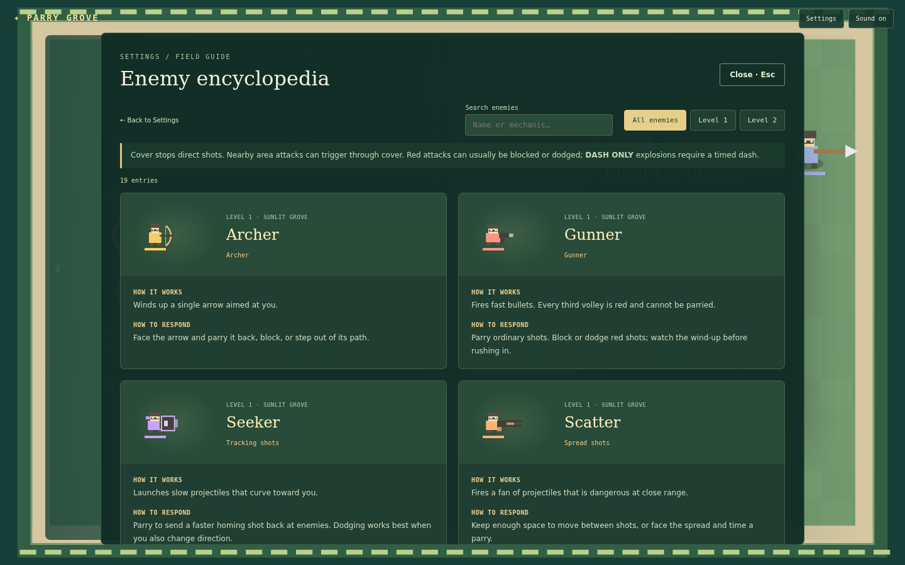
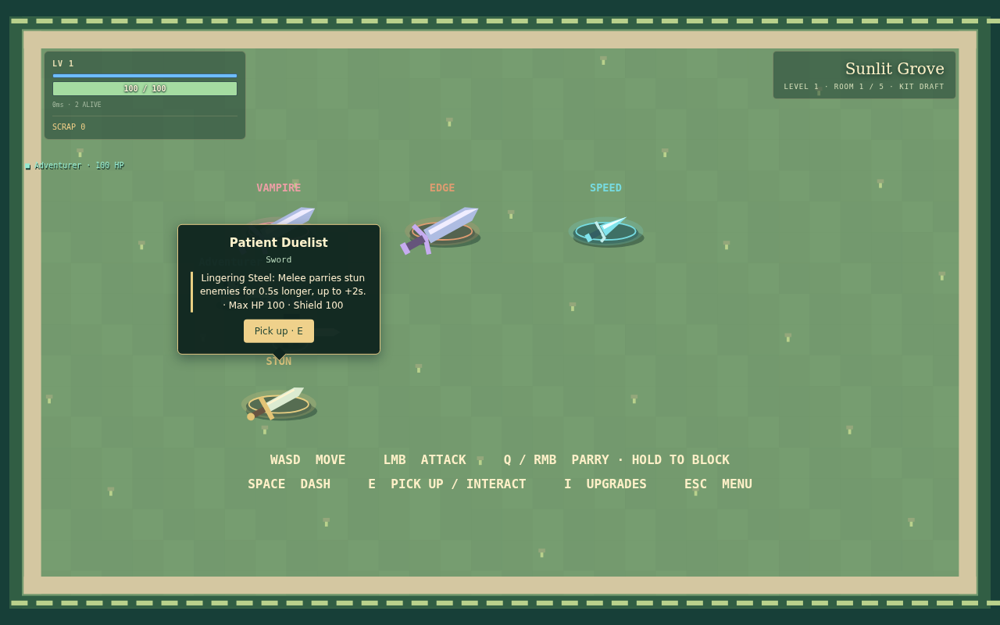
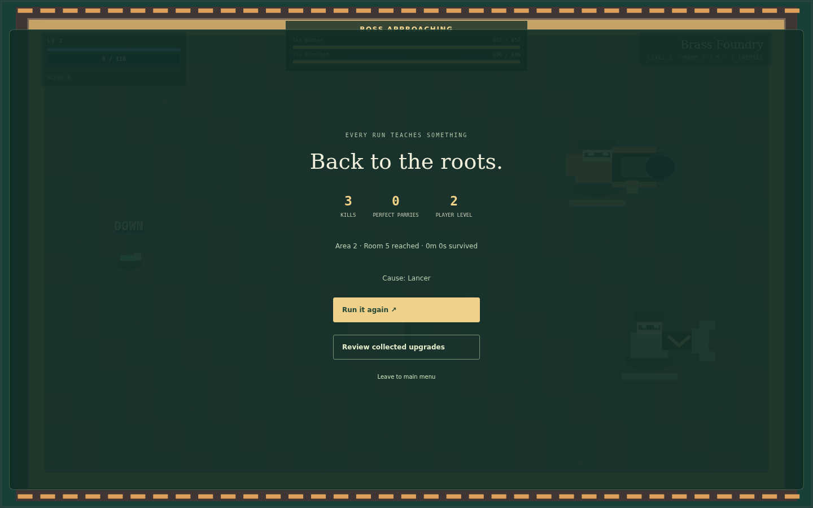

# Playtest usability and combat readability

Based on main `a681e1b` (the merged game-feel pass). No balance, parry-window,
windup, reward, dash-distance, reflected-targeting or progression changes.

| Area | Before | Result |
| --- | --- | --- |
| Encyclopedia | Broken after feedback context was added to enemy drawing | Static portraits use a complete Renderer; defensive lookup supports minimal contexts. Each portrait catches failures independently and keeps mechanics readable. |
| Starting kits | Physical exclusive draft present; HP comparison treated equipment as a hit | Authoritative cumulative HP damage separates real damage from equipment changes, including damage in the same snapshot. Equipment confirmation states resulting HP/shield. |
| Shield/HUD help | Correct block-capacity mechanics, unexplained | Optional controls/HUD guide and practice explain bypass, break, recovery, internal damage, level and Scrap. No new shield mechanics. |
| Developer tools | Normal Settings exposed host-only cheats | Separate opt-in page. Client flag and independent server permission default off; host/session authorization remains required. |
| Tutorial | Missing | Optional first-run offer; eight actionable lessons in a disposable local world; replay/skip and local completion. Same movement, attack, guard, dash and hit-pause functions. No rewards/network progression. |
| Failed guards | Repeated MISS labels | Viewer-local NO CONTACT, at most once per 800ms, above the player. No fabricated early/late reason. Practice reports actual contact outcomes. |
| Kit explanation | Perk names and partial tradeoffs | Upgrade registry descriptions, actual HP/shield, distinct accents/emblems, immediate result, dim claimed pickups and ownership messages. Physical E interaction retained. |
| Enemy recognition | Equipment mostly distinct; generic bodies and persistent Foundry state labels | Heavy shoulders, slender roles, launcher packs, cosmetic anticipation; miner stance/direction/cooldown glyphs and bomber shield outline replace persistent labels. Existing danger geometry and timing retained. |
| Background | Dense floor contrast/flowers/grate lines | Tile contrast blended toward base; sparse flowers and Foundry lines/embers. Obstacles and warnings retained. |
| Boss presentation | Boss meters inside room panel; safe intro already existed | Dedicated top-center names/meters and brief BOSS APPROACHING state use the existing attack-suppressed intro. No extra waiting or mechanic changes. |
| Combat polish | Directional contacts, trails, flinch, dash ghosts, Scrap flight, green parry edges and capped audio/effects already present | Retained and directly rechecked; no duplicate layers. Failed-feedback cap added to centralized FEEL configuration. |
| Settings/results | Missing accessibility controls, terse results, plural bug | Persistent reduced motion/flashes and effects volume; singular ENEMY; brighter draft instructions; actual lethal-contact room/time/source with fallback; player-level wording and fast retry. No music system exists. |

## Preserved mechanics

- Solo hit pause remains **50ms melee / 90ms perfect / none regular**. Multiplayer
  still uses the shared engine without hit pause. Prediction does not emit hit effects.
- Perfect streak resets only on actual HP loss or three-second expiry. Practice
  lesson changes do not reset the streak. Dagger display still counts actual parries.
- Shield pays full raw block damage; held blocks reduce HP damage 80%. Ordinary hits
  and regular parries bypass capacity. No timed/room regeneration. New area restores
  capacity; Perfection repairs 5 per perfect only up to 50 remaining.
- Internal damage persists across room traversal, clears at area advancement, and
  retains existing melee/Sword-perfect recovery and unguarded-hit release.
- Compact HUD placement, 1.5× health/shield widths, opacity, Scrap and level placement
  are retained. The boss meters use the central top space above the streak.

## Validation

- **46 focused checks pass.** Engine/render/audio/transport checks cover every enemy/boss portrait,
  every kit, same-snapshot actual damage, shield rules and room/area transitions,
  death metadata, default-denied/host-only admin authorization, feedback throttling,
  streak resets, solo-only hit pause and interaction effects.
- `npm run lint`, `npm run typecheck`, `npm run build`, and the production Worker/D1
  smoke test pass.
- Full suite: **201/218 pass**. The same **17 named failures** reproduce on untouched
  main (**192/209 pass**): older combat/Foundry expectations, simulation goldens,
  contact-purchase shop tests and former permanent-sacrifice behavior. They were
  not changed to disguise failures or to alter current game balance.
- `scripts/playtest-smoke.mjs` drives the actual Game and Tutorial components in a
  test-only browser bundle. It checks all 19 menu and active-run portraits, pause/
  resume, a deliberately broken portrait's isolation, all eight lessons using real
  keyboard/mouse timing, completion/replay/skip, all kits/resulting stats without hurt
  popups, a melee-cleared room and reward, twin-boss HUD, saved preferences, death
  source and retry. Deterministic world setups use a bridge injected only by the
  test bundler; no test endpoint or bridge is shipped in the application.
- `scripts/coop-ui-smoke.mjs` runs **two actual browser clients** against the real
  Worker/D1/Durable Object API and WebSockets. One browses all encyclopedia entries
  while the other moves and the authoritative clock continues. An authenticated
  host's admin request is denied in the default production configuration.
- The two-socket regression also checks shared shield/internal values, event-ID
  deduplication, continuing movement/streak timers and contact metadata.
- Existing `scripts/game-feel-smoke.mjs` rechecks melee/perfect effects, repeated
  dash input, mass immediate Scrap rewards and completed HUD flights, damage,
  rewards, boss effects, reduced motion and crowded four-player rendering.
  Test-fixture draw samples: 32-enemy median 1.1ms/p95 20ms; 180-enemy median
  2.1ms/p95 19ms. These are local software-rendering samples, not a hardware or
  sustained-frame-rate guarantee. Particle/ring/ghost caps remain enforced.
- Browser runs reported **no uncaught page errors**. Browser result JSON files
  are alongside the captures. Test browser uses software Canvas rendering.

## Limits

The full application shell/controls run in a CSR test fixture, and the built SSR
Worker is smoke-tested separately. Local two-client coverage does not establish
cross-internet latency or four-human playfeel. Audio signals and budgets are
checked programmatically; subjective loudness/timing still benefits from human
playtesting. Later bosses/death were reached with controlled test setups rather
than a complete normal-health campaign. Floor/role changes deserve human review
in both biomes. The pre-existing full-suite failures remain visible.

## Captures










## Local verification

```sh
npm test
npm run lint
npm run typecheck
npm run build
node tests/build-smoke.mjs
PLAYWRIGHT_MODULE=/path/to/playwright/index.mjs BROWSER_EXECUTABLE=/path/to/chromium node scripts/playtest-smoke.mjs
PLAYWRIGHT_MODULE=/path/to/playwright/index.mjs BROWSER_EXECUTABLE=/path/to/chromium node scripts/coop-ui-smoke.mjs
```

Local developer panel opt-in:
`VITE_ENABLE_DEV_TOOLS=true ENABLE_DEV_TOOLS=true npm run dev`.
The first flag is presentation only. The second is a trusted Worker binding checked
at the server boundary, independently of any submitted JSON and the client flag.
