# UI and visual-feedback polish

Base: main `97d9f3f`, including the merged encyclopedia/tutorial fixes. This pass
changes presentation and client input handoff, not combat balance or authoritative
progression. The audit used the standard: would this read and behave correctly in
a production game? Existing good feedback was retained rather than doubled.

## Complete requirement audit

| # | Previous state | Final change and review |
| --- | --- | --- |
| 1 · Rewards | Partial; broad `.reward > span` rules enlarged rarity into headline text | Root selectors narrowed to icons. Shared 12px badges occupy a fixed top-left row. Equal cards reserve name/description/footer space; numerals receive selective emphasis; keycaps read Select. Muted rarity colors remain distinct from hover, keyboard focus and committed selection. A 280ms local confirmation survives the reward-to-route transition without delaying the authoritative reward. |
| 2 · Inventory state | Incorrect after death/victory | Pure state-derived copy distinguishes live solo, co-op combat, peaceful progression, area clear, death and victory. Terminal inventory returns to results even when opened from a run menu. Ended runs cannot acquire a misleading pause menu. Victory duration latches the actual completion event rather than continuing to count while browsing. |
| 3 · Kits | Correct values but cramped paragraph | Name, weapon, icon/perk, numerical effect and aligned HP/block-capacity rows are separate. Reduced starting stats are explained as tradeoffs. Registry descriptions remain authoritative. Side placement keeps the pickup, player and compact HUD visible. All eight kits reviewed. |
| 4 · Failed parries | Throttled but visually prominent NO CONTACT | Ordinary failed attempts use the existing guard animation and no floating failure text/sound. Optional coaching and practice retain small, rate-limited contact feedback with no invented early/late judgment. Perfect/regular/block feedback stays distinct. |
| 5 · Damage numbers | Nearby hits could merge across targets or overlap | Short grouping requires the same source and target; simultaneous groups use separate bounded lanes. Outgoing, incoming and healing use different colors/positions. Internal accumulation keeps its amber HUD treatment. Consistent outlines, capped lifetime and modest significant-hit emphasis. No damage values are changed. |
| 6 · Critical health | Missing persistent cue | A maximum-HP-relative 20% threshold adds a restrained bar treatment, LOW HEALTH metadata and static edge tint. Recovery removes them immediately. Reduced motion disables the gentle bar breathing; there is no continuous screen flash. |
| 7 · Settings controls | Native blue slider and white checkbox | Themed gold/sage range and toggle controls, percentage/accessible volume text, comfortable targets, focus and muted-state explanation. Existing saved values remain supported. Other text/select/button states use the same palette. |
| 8 · Practice layout | Different HUD inset and browser-edge lesson panel | Same PlayerHud and arena-ui spacing as live play. Lesson card sits inside the safe area. Training action moved above its reserved panel area; a 1000×650 capture/check confirms clearance. |
| 9 · Practice handoff | Button focus could consume Space | Lesson focus now moves in a layout effect after the new DOM commits. Advancing and pressing Space requires no extra click. Deliberate UI focus remains keyboard-accessible; genuine focus loss stops practice inputs and offers Click to resume controls. |
| 10 · Practice success | Text and enabled button only | Shared success icon, complete-state border and brief check near the action acknowledge every objective. Next is obvious and responsive. All eight lessons still use real input/combat functions; skip/replay/completion remain isolated. |
| 11 · Help | Dense mixture of basics and exceptions | Eight illustrated basics, a visual HP-versus-capacity example, and expandable advanced guard/internal/streak details. The blue bar's ordinary-hit bypass is explicit in both help and the block lesson's live values. |
| 12 · Lobby | Advertised Sword before drafting | Host/party role and Kit not selected are derived from actual kit state. Readiness remains separate. Create/join/copy/ready/start/leave and reconnect transport are retained. |
| 13 · Typography | Inconsistent font roles and status sizes | Shared title/copy/metadata font roles: serif major headings, readable sans content, selective monospace values/keycaps. Applied to reward, inventory, kit, settings, help, lobby, pause, practice, results and notifications. |
| 14 · Icons | Platform-dependent Unicode upgrade art | One pixel-style path library drives SVG UI icons and cached Canvas vending icons. Shared padding, optical area, stroke weight and neutral supporting color; recognizable silhouettes/sigils do not depend only on color. No outside assets. |
| 15 · Player recognition | Light ring and always-visible solo name | Restrained dark body/head contour and color marker, with slot notches for additional differentiation. Solo names can be hidden (default) in saved Settings; co-op names remain useful and sit above incoming-number lanes. |
| 16 · Weapon contact | Already implemented well | Retained actual-contact flashes, directional particles, reach-aligned trails, cosmetic enemy reactions, separate hit/parry audio and reflected ownership trails. Rechecked together with quieter numbers and stronger player silhouette. No stacked duplicate effects or combat timing changes. |
| 17 · Transitions | Reveal effects existed; selection vanished quickly and input/focus could leak | Consistent short surface/reveal/confirmation rhythm. Synchronous choice guard covers clicks and number keys; held inputs clear at handoff. Focus goes to reward, arena, lesson or results as appropriate. Shared co-op simulation stays live; a new combat snapshot dismisses the cosmetic reward surface immediately. Existing safe boss intro remains unchanged. |

## Production-quality review

- Hierarchy: screen title first, upgrade name next, compact rarity/keys supporting.
- Alignment: equal card dimensions and name/description/footer rows verified at
  1440, 1024 and 900px widths; long synthetic name/description checked at 1000×720.
- Interaction: hover lifts without resizing; keyboard outline differs from selected
  inset/pulse. Disabled options cannot activate. Sound-off copy explains saved volume.
- State: ended inventory says Back to results, co-op copy does not promise a pause,
  and the lobby does not claim an undrafted weapon.
- Next action: consistent keycaps, clear objective completion and primary buttons.
- Combat: no normal NO CONTACT spam; source/target accounting survives aggregation;
  critical health is persistent but restrained; names and damage use separate areas.
- Layout: kit cards flank pickups rather than overlap the HUD; short-height practice
  keeps the action above instructions. Help/settings scroll inside their surface.
- Consistency: a shared palette, badge, numerical-text treatment and icon path library
  replaces the mixture of native defaults and platform-dependent upgrade symbols.

## Validation

- **52 focused checks pass.** Six new semantic regressions cover terminal/live inventory
  copy, undrafted lobby information, relative critical-health thresholds, optional
  coaching, source/target number aggregation and incoming/outgoing separation.
- **Lint, typecheck, build and the built Worker/D1 smoke test pass.**
- Full suite: **207/224 pass**. The same **17 named failures** exist on main
  (**201/218 pass**); checks.json records them. Existing combat expectations,
  simulation goldens, former contact-purchase shops and permanent-sacrifice tests
  were not rewritten to alter balance or hide baseline failures.
- `ui-polish-smoke.mjs`: all rarities, long content, geometry at three widths, hover,
  number-key selection, visible confirmation, duplicate/input gate (held movement before/during confirmation and Space selecting without a dash), physical route,
  all eight kit layouts, critical-health recovery, percentage/settings/help,
  inventory after death from a run menu and after victory, immediate Space after
  lesson advance, and short-height action clearance. No uncaught page errors.
- With `UI_CAMPAIGN=true`, the actual client completes **all ten rooms**, both area
  bosses, shops/routes, rewards, area advancement and victory using controlled
  high-HP/high-damage setups and real client attack/selection/movement inputs.
  This verifies progression/UI continuity; it is not a normal-health balance test.
- The existing playtest browser suite passes all eight real-input practice lessons,
  completion/skip/replay, all kits/stat outcomes, the full encyclopedia and isolated
  preview failure, solo pause, boss HUD, saved accessibility preferences and retry.
- **Two browser clients** against the actual Worker/D1/Durable Object and WebSockets:
  live server melee clears a seeded encounter, both receive natural rewards, one
  waits while the other chooses, and only then does the party enter the route.
  Another two-client test verifies lobby copy, encyclopedia browsing while the
  other client moves/the shared clock advances, and default-denied admin actions.
- Existing game-feel browser checks pass for melee/perfect contact, dash, immediate
  Scrap and HUD flights, HP/internal treatment, reward/boss effects, reduced motion
  and crowded four-player rendering. Effect/audio caps and event deduplication are
  retained. Result JSON files are beside the captures.

Browser controls use a CSR test bundle with test-only deterministic world setup;
the production SSR Worker is checked separately. No test bridge, seeded encounter
endpoint or extra developer permission is shipped in the game.

## Remaining limitations

No subjective listening test, four-human session or cross-internet latency trial
was performed. The complete campaign used controlled stats, not normal-health
human play. Safari/Firefox and small phone layouts have not received the same
coverage as Chromium desktop. The existing 17 full-suite failures remain visible.
These limits do not represent inferred balance defects.

## Before / after

The before captures use the unmodified merged source; the after captures use this
branch. All capture setup is local and isolated from production.

| Surface | Before | After |
| --- | --- | --- |
| Reward cards | 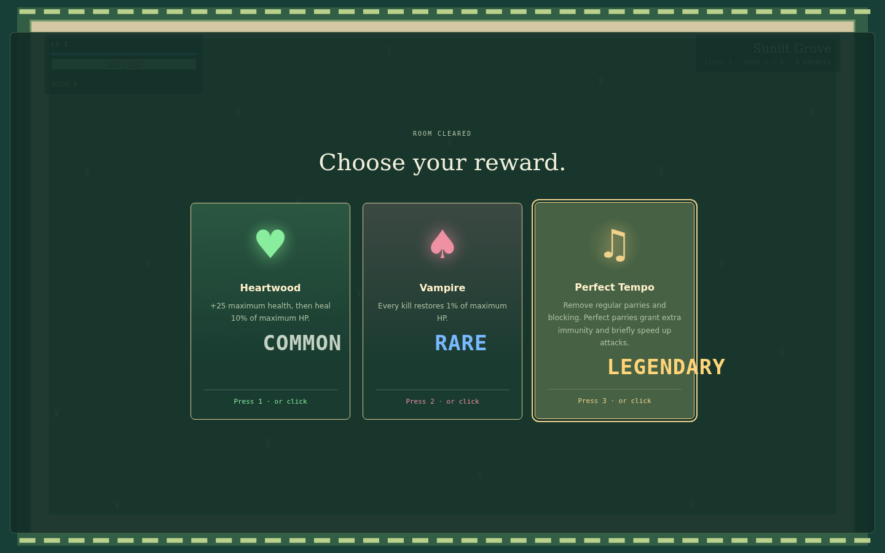 | 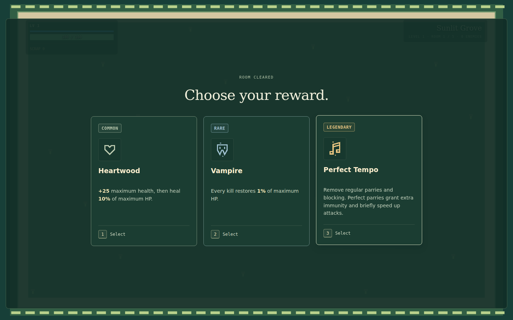 |
| Kit details | 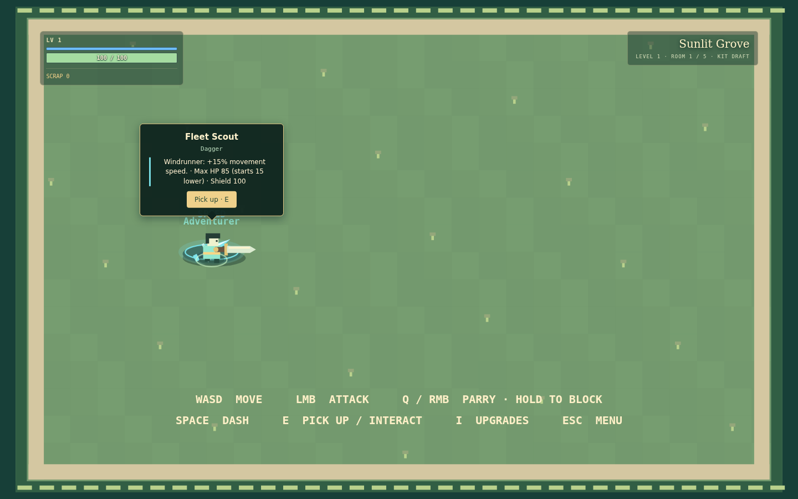 | 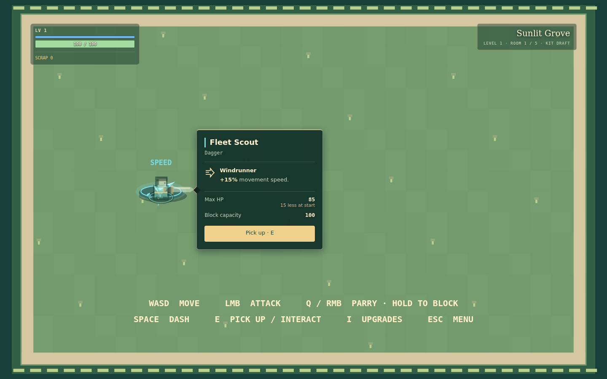 |
| Practice | 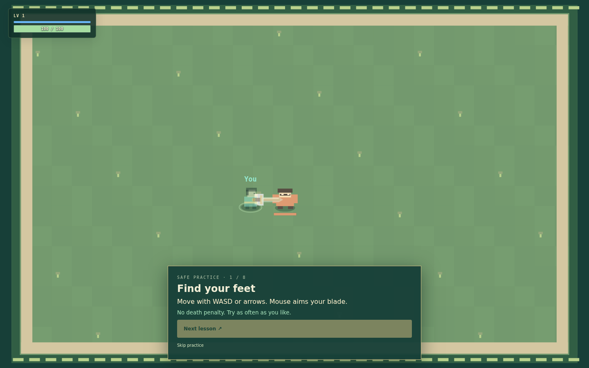 | 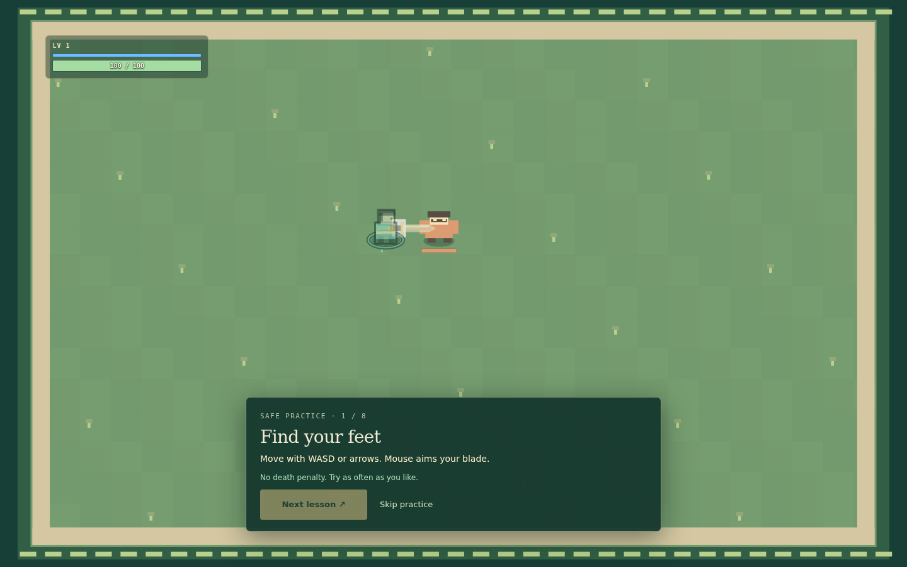 |
| Settings | 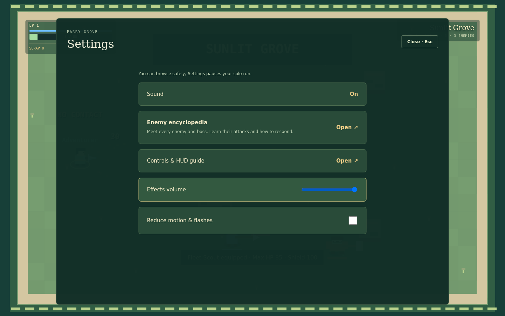 | 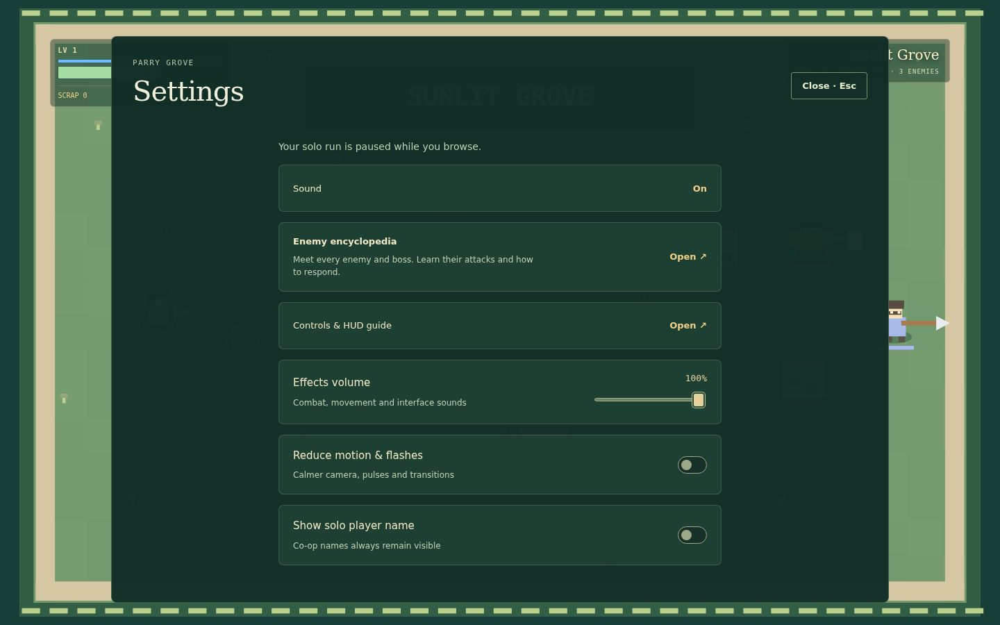 |
| Combat feedback | 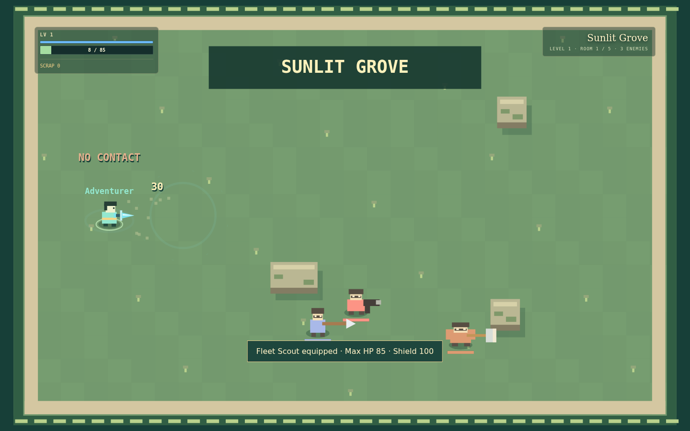 | 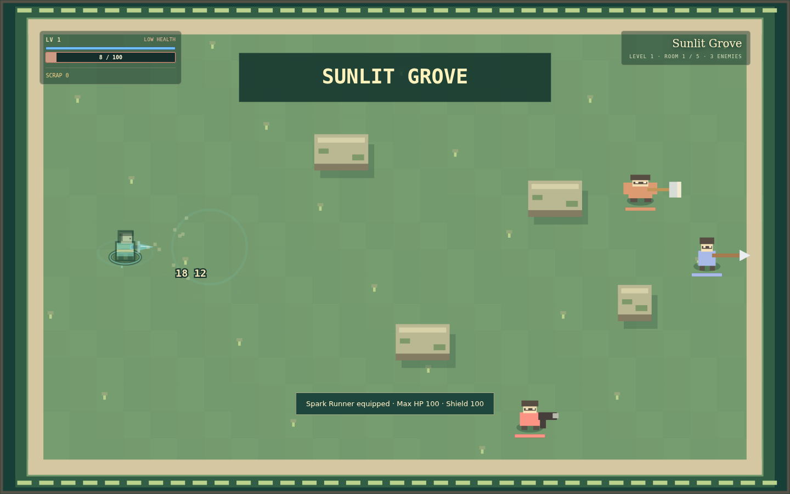 |
| Post-death inventory | 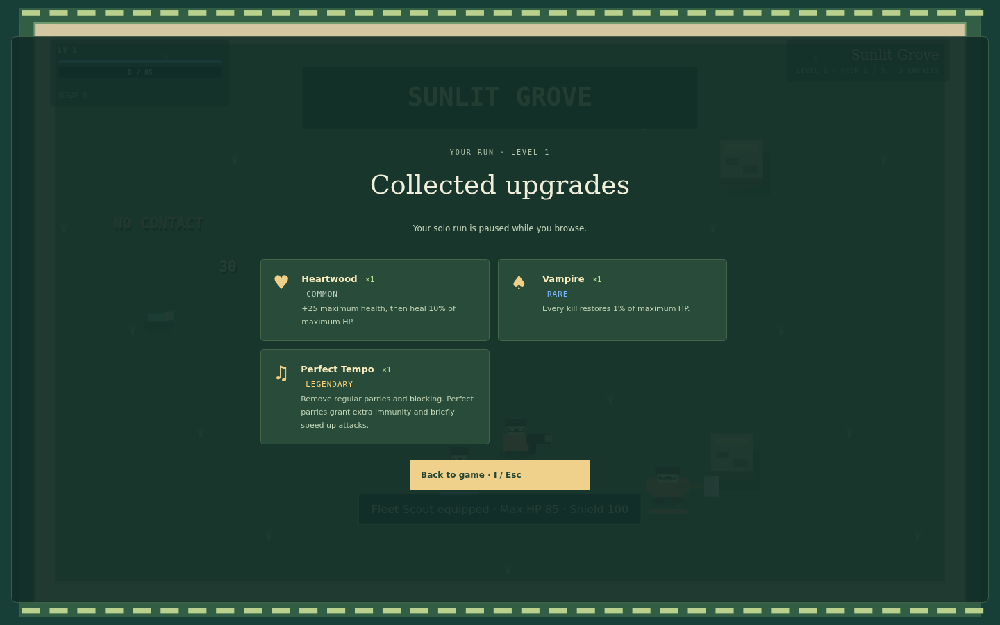 | 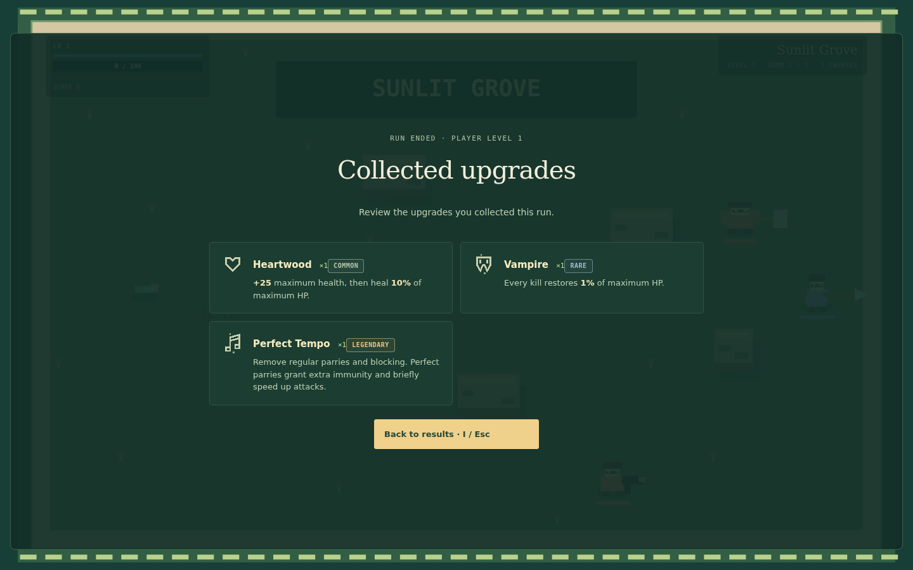 |

[Long reward content](ui-polish/after/rewards-long.webp) ·
[Selection confirmation](ui-polish/after/reward-confirmation.webp) ·
[Short practice viewport](ui-polish/after/practice-short.webp) ·
[HUD guide](ui-polish/after/help.webp) ·
[Foundry bosses](ui-polish/after/boss-1-4.webp) ·
[Completed run](ui-polish/after/victory.webp) ·
[Lobby state](ui-polish/after/lobby.webp) ·
[Co-op reward handoff](ui-polish/after/coop-rewards.webp)

## Reproducing browser checks

```sh
npm test
npm run lint
npm run typecheck
npm run build
node tests/build-smoke.mjs
# Provide a local Playwright module and Chromium executable:
UI_CAMPAIGN=true PLAYWRIGHT_MODULE=/path/to/playwright/index.mjs BROWSER_EXECUTABLE=/path/to/chromium node scripts/ui-polish-smoke.mjs
PLAYWRIGHT_MODULE=/path/to/playwright/index.mjs BROWSER_EXECUTABLE=/path/to/chromium node scripts/coop-combat-smoke.mjs
# Before captures use an untouched checkout:
UI_SOURCE=/path/to/main UI_CAPTURE_MODE=before PLAYWRIGHT_MODULE=/path/to/playwright/index.mjs BROWSER_EXECUTABLE=/path/to/chromium node scripts/ui-polish-smoke.mjs
```
